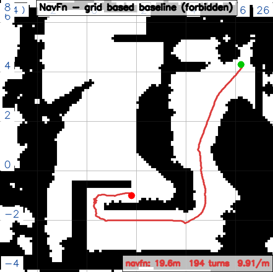
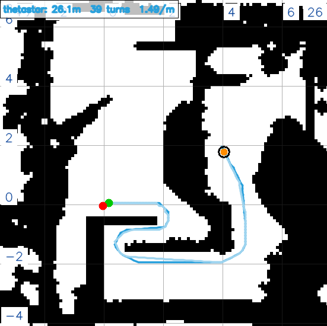
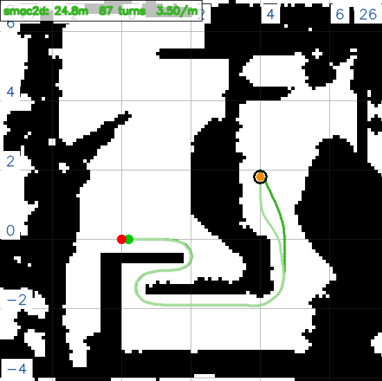
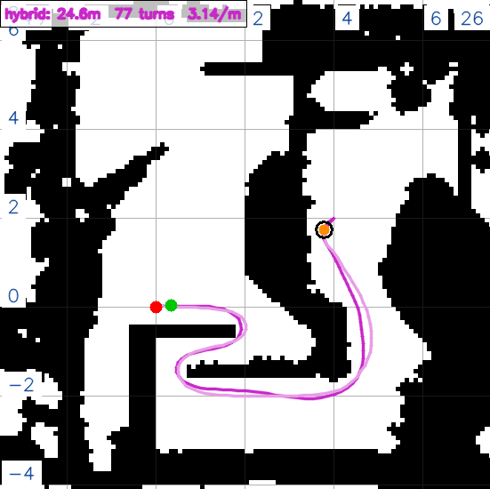
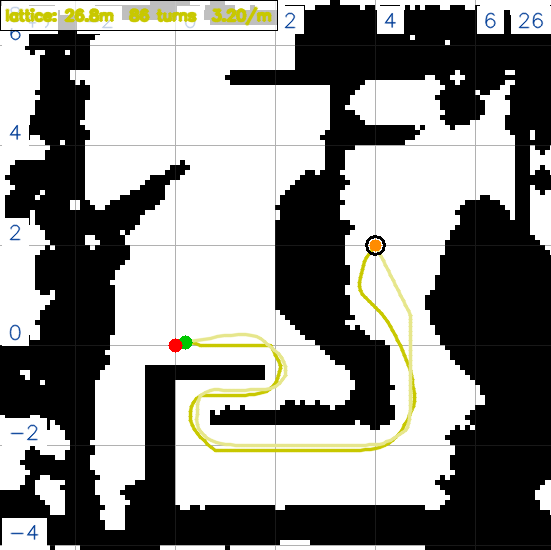

# 导航方向大作业 · 哨兵全局规划器改造

> 作业：《2027 赛季算法组培训考核作业细则》§3 导航方向

> 提交仓库：https://github.com/gebilaowuxiaoyu123/RMCS_Navigation

---

## 0 一页速览

| 细则要求 | 我们的答案 | 证据 |
|---|---|---|
| 换掉现在的全局规划器 | 换成 `nav2_smac_planner::SmacPlannerLattice`，配自建的 10 cm 全向原语文件 | §3.3、`config/motion.yaml` |
| 讲清选型理由与现规划器的差异 | 五个候选在两张图上各跑同一起终点，比长度 / 转弯 / 曲率 | §3.1 ～ §3.4 |
| 调参做到无明显卡顿 | 逐项核对参数是否真正生效，把膨胀层调到能用 | §4.3、§4.4 |
| 讲调参思路 | 先确认"这个参数到底生不生效"，再决定改不改 | §4.1、§4.2 |
| 实际场地跨场导航 | 静态验证、重定位、手动导航，链路已打通 | §5、§6 |

一句话：这一轮真正花时间的不是"选哪个规划器"，而是搞清楚**哪些参数其实根本没生效**。前者两小时能定，后者花了整整六天。

---

## 1 作业要求与本文结构

细则里有三条验收要求，本文按这三条组织：

1. 选型：为什么选它、和现有规划器差在哪（§3）
2. 效果演示与代码提交（§5）
3. 调参思路（§4，本文重点）

另外两节：§2 是整条技术链的总览，§6 是唯一还没解决的问题（上坡）。

---

## 2 技术链总览

调参不只是"改一改 `motion.yaml`"。真正让车动起来，下面每一步都得过：

| # | 环节 | 做了什么 | 证据 |
|---|---|---|---|
| 1 | 摸清基线 | `ros2 param get /planner_server GridBased.plugin` 回读，确认现网就是 `NavfnPlanner` | 实验记录 9月22日 |
| 2 | 静态验证 | 用 `static.launch.yaml` 加独立 configuration 目录，五个规划器在 **RMUC 和战队两张图上**各跑同一起终点，不改仓库里的任何文件 | `tools/plot_path.py`、12 张图 |
| 3 | 参数对照官方文档 | 拉 Nav2 1.3.11（jazzy）源码，逐个核对本车 `motion.yaml` 里哪些参数写了但不生效 | 实验记录 10月2日 |
| 4 | 换规划器落盘 | 只改 `plugin` 一行，加上 Lattice 的 `lattice_filepath` | `config/motion.yaml` |
| 5 | 自建原语文件 | 官方 demo 的原语是 5 cm 阿克曼车用的，与 0.1 m 的代价图对不上；按 10 cm 全向重做 | `lattice/omni_10cm.json`（16 航向 / 136 条） |
| 6 | 重定位辅助测试 | 对齐 `rmcs-localization` 子模块版本、改初值，让手动导航有个可信起点 | §4.2 E4 |
| 7 | 端点适配 | 注释掉 `train.lua` 的意图调度才能收手动目标；`switch_motion_mode` 从 attack 改 normal | §4.2 E2 |
| 8 | 实车验证 | `sync-remote` 加 `attach-remote -r`，按车实际跑动的情况调参 | §5.3 |

---

## 3 验收① 选型

### 3.1 横向对比

先交代背景：**这不是一次从零开始的选型。** 队长已经把细则不允许的几个（包括现网在用的 `NavfnPlanner`）排掉了，我们的任务是在剩下能跑的规划器里挑一条能用的。所以下面的对比只回答一个问题：同一条路线，五个规划器各跑成什么样。

**RMUC 比赛场地**（`rmuc-v2.png`；起终点沿用 9月28日 那组 `(0,0)` 到 `(20,0)`）


这张图上有一处很显眼：**Lattice 在直线路段会突然拐出一道弧线，到终点附近还会以螺旋的方式绕进去**；另外四个都是一条折线走到底。这个现象单独放在 §3.4 说。

**战队训练场**（`战队.png`）。实际任务是到终点还要回起点，所以画的是往返轨迹：深色是去程、浅色是回程、橙点是掉头位置。五个规划器分别放单张：

**NavFn（现网基线）**



**ThetaStar**



**Smac2D**



**SmacHybrid**



**SmacLattice**



> 两张图的配色统一：红 NavFn ｜ 蓝 ThetaStar ｜ 绿 Smac2D ｜ 紫 SmacHybrid ｜ 黄 SmacLattice。单张图在 `assets/rmuc/` 与 `assets/zhandui/` 下，文件名 `path_<规划器>.png`。

### 3.2 实测数据

**RMUC `(0,0)` 到 `(20,0)`（单程）**

| 规划器 | 长度 | 转弯数（>5°） | 转弯密度 | 最大转角 |
|---|---|---|---|---|
| NavFn（现网基线） | 34.79 m | 91 | 2.62 次/m | 94.1° |
| ThetaStar | 34.09 m | 25 | 0.73 次/m | 49.8° |
| Smac2D | 34.06 m | 46 | 1.35 次/m | 8.7° |
| SmacHybrid | 34.06 m | 43 | 1.26 次/m | 23.3° |
| SmacLattice | 37.99 m | 74 | 1.95 次/m | 116.3° |

**战队 `(0,0)` 往返 `(4,2)`**

| 规划器 | 往返全长 | 转弯数 | 转弯密度 | 去程 / 回程 |
|---|---|---|---|---|
| NavFn | 30.27 m | 216 | 7.14 次/m | 14.29 / 15.96 |
| ThetaStar | 26.11 m | 39 | 1.49 次/m | 13.09 / 13.03 |
| Smac2D | 24.83 m | 87 | 3.50 次/m | 12.43 / 12.40 |
| SmacHybrid | 24.55 m | 77 | 3.14 次/m | 12.16 / 12.40 |
| SmacLattice | 27.37 m | 88 | 3.22 次/m | 13.96 / 13.41 |

两处需要解释：

**一、NavFn 的"碎"是什么意思。** 看战队那一列：它每往前 14 cm 就要拐一次弯（7.14 次/m），是其他四个的两倍以上。也就是说它给出的是一串紧挨着的小折线，每两段之间都有个 5° 以上的转角，视觉上就是一条锯齿。**但要注意：在这张图上 NavFn 本身是能跑通的**（转弯多不等于跑不通）——早期的记录把这一点写错过了，已勘误。

至于队长为什么不用 NavFn，那是队长当时的判断，我们没有去追问，直接开始试新的。

**二、往返表里的"最大转角"不能拿来比。** 去程和回程方向相反，终点那个动作也不是阿克曼式的掉头，而是**车停下来、然后直接往回走**，所以这个量只反映几何，不代表路径好不好。真正能拿来比的只有全长、转弯数和转弯密度。

### 3.3 三条理由

**① 只有它能表达"全向"这件事。**

本车是舵轮全向底盘，可以横着走、斜着走。`SmacPlannerHybrid` 这类插件是为**车式底盘**设计的（有最小转弯半径），拿来跑全向底盘，等于凭空给车加了个转弯半径，窄口就更进不去。

而 Lattice 的运动能力由**原语文件**决定。这里解释一下"原语"是什么：它是一张预先算好的表，里面是一条条**小车实际能做的动作**——直行、斜着走、原地转、拐一段小弧线等等。规划器做的就是从这张表里挑动作、把它们串起来。我们把原语做成全向的，它就真能横着走。

**② 原语文件是自己写的，能对上代价图。**

官方自带的 demo 是 5 cm 分辨率的阿克曼原语，而本车代价图分辨率是 0.1 m，两者对不上（原语比格子还细）。我们自己做了 10 cm、16 个航向、136 条原语的版本，和代价图一一对应。

**③ 它是五个里表现最稳的那个。**

RMUC 那张表上，`Smac2D` 的最大转角 8.7° 最漂亮，但它是纯栅格搜索、没有运动学概念；Lattice 的长度和转角都处在中间，没有明显短板。

> 说实话，最终落在 Lattice 上，有相当一部分是"在能跑的几个里试出来它最顺手"。

### 3.4 与 NavFn 的差异

一句话：**NavFn 给的是一串格子中心点的连线（折线）；Lattice 给的是一条条"小车能做的动作"串起来的轨迹。**

区别在控制器的感受上：折线本身没有速度和朝向的概念，控制器得自己想办法把车"拽"到那条线上；而轨迹带着朝向和动作，控制器跟着走就行。

另外补一段 Lattice 的毛病，也就是 §3.1 提到的那处：

在 RMUC 那张图上，它直线走得好好的会突然拐出一道弧线，到终点附近则是螺旋式绕进去。原因是它在每一步都从原语表里挑"当前这一步最优"的动作——当直行原语没有占到绝对优势，它就会挑一条带弧的。

影响有两点：路径会比栅格类的长一点（RMUC 上 37.99 m，其他四个都在 34 m 附近）；但整条路径对底盘是可执行的。

### 3.5 对比用的是默认参数

选型对比里，五个规划器**全部用 Nav2 上游默认值**，只有 Lattice 改了一处：`change_penalty` 从 0.05 抬到 1.0。

原因是默认值下 Lattice 会给出穿墙的路径（详见 §4.7）。

这一点要和实车分开看：**实车那套 `motion.yaml` 是反复调出来的**，静态对比刻意保持"没调过"的状态，否则比的就成了"谁被我调得多"。

---

## 4 验收③ 调参

### 4.1 改动轨迹


灰色是"试过之后又退回去的"，橙色是"反复试过好几个值的"，蓝色是"最后留下的"。

从图上一眼能看出两件事：**回退特别多**（说明大部分尝试是无效的），真正定下来的参数集中在 10月1日 之后。

调参过程走了几条弯路：

1. **一开始是"按现象调"**：车不敢进窄口就缩 `inflation_radius`，车摆就抬 `PathAlignCritic`。**改了三次，实车表现完全一样。**
2. **后来改成"先确认参数到底生不生效"**：去源码和官方文档里核对参数名、核对参数写在哪个层级。**一次就中。**
3. **10月1日 之前一直没开重定位**，导航起点一直是错的；端点也从 `free.lua` 换成了 `train.lua`，两者行为不同（`free.lua` 根本不调重定位），换完之后下面几节的编号也跟着变了。
4. 早期还试过一批 MPPI 的噪声和温度，摆的幅度有变化、机制没变；最后留下来的是 `temperature 0.34`、`vx_std` / `vy_std 0.55`。

**过程中被改过的参数（含后来退回去的）**

| 参数 | 范围 | 试过的值 | 最终 |
|---|---|---|---|
| `GridBased.plugin` | 全局规划器 | NavfnPlanner ／ SmacPlanner2D ／ SmacPlannerLattice | **SmacPlannerLattice** |
| `lattice_filepath` | 全局规划器 | （新增） | **`omni_10cm.json`** |
| `tolerance` | 全局规划器 | 0.5 ／ 0.25 | **0.25** |
| `non_straight_penalty` | 全局规划器 | 默认 1.05 ／ 2.4 | **2.4** |
| `change_penalty` | 全局规划器 | 默认 0.05 ／ 1.0 | **1.0** |
| `retrospective_penalty` | 全局规划器 | 默认 0.015 ／ 0.04 | **0.04** |
| `max_planning_time` | 全局规划器 | 5.0 ／ 10.0 | **10.0** |
| global `inflation_radius` | 全局代价图 | 0.5 ／ 0.35 ／ 0.28 | **0.28** |
| global `cost_scaling_factor` | 全局代价图 | 0.5 ／ 1.5 ／ 1.0 | **1.0** |
| local `inflation_radius` | 局部代价图 | 0.5 ／ 0.2 ／ 0.38 | **0.38** |
| local `cost_scaling_factor` | 局部代价图 | 0.5 ／ 1.5 ／ 0.55 | **0.55** |
| `critical_cost` | MPPI 代价 critic | 120 ／ 300 | **300.0** |
| `PathAlignCritic.cost_weight` | MPPI 跟线 critic | 0.8 ／ 5.2 ／ 7.5 ／ 10.0 | **7.5** |
| `xy_goal_tolerance` | 目标检查 | 0.1 ／ 0.25 | **0.25** |
| `temperature` / `vx_std` / `vy_std` | MPPI | 0.3→0.34 ／ 0.2→0.55 | **0.34 / 0.55 / 0.55** |

这些值的来历逐条写在实验记录里。

### 4.2 事件复盘


#### E1 · 改了三次、毫无反应（9月29日）

问题：车到窄口不敢进，`/plan` 明明有路径，车就是停在门口。

现象：连改三刀——`inflation_radius` 0.5 改 0.35、`cost_scaling_factor` 0.5 改 1.5、`critical_cost` 120 改 300——**前两刀实车表现完全一样**。

原因：当时 `critical_cost` 还是 120，而膨胀带里的代价本来就在 200 以上，等于整条带都被判成"要撞"。这种情况下缩 `inflation_radius` 只是把"被判要撞的范围"缩小了一点，带里还是天价。把 `critical_cost` 抬到 300 之后才真正起变化。

影响：定下两条规矩——一次只动一个参数；改之前先确认这个参数到底有没有被节点读进去。

#### E2 · "摆"的问题不在局部控制器（9月30日）

问题：车一直在走，但车身左右摆，还会转小陀螺。

现象：`temperature`、`vx_std`、`vy_std` 全试了一遍，摆的幅度变了，机制没变。

原因：两件都不是 MPPI 参数的事。一是 `/cmd_vel` 从 Nav2 传到舵轮中间没有滤波，方向一抖舵轮就跟着摆；二是端点里 `switch_motion_mode = "attack"` 会让底盘进入小陀螺模式。

处理：`switch_motion_mode` 改成 `normal`，摆的问题就消失了。

（顺便踩了个坑：`motion.yaml` 里当时还挂着一个早就没用的 `smoother` 配置，白改了半天的平滑参数其实一个字都没生效。）

#### E3 · 两种"整条栈起不来"（10月1日）

问题：改完参数重启，代价图、`/plan`、`/trajectories` 话题全没了。

判定：`ros2 lifecycle get /planner_server` 返回 `unconfigured [1]`，而不是 `active [3]`。

两次是不同原因：

1. `plugin:` 的值被清空了（改文件时整行被覆盖），`planner_server` 不知道该加载谁；
2. `non_straight_penalty: 2` 少写了小数点。这个参数声明的是 double，写成整数会让节点直接 FATAL：`parameter {...} is of type {double}, setting it to {integer} is not allowed`。

处理：写了个小脚本扫 `motion.yaml`，把"声明为 double 却写成整数"的参数全找出来，改完先跑一遍。这个坑后来还踩过一次，就是脚本兜住的。

#### E4 · 重定位：两个问题叠在一起（10月1日）

问题：手动给目标后，车朝着一个莫名其妙的方向走。

现象：`rmcs_localization` 报 `relocalize ignored: trigger fifo ... is not available`；改成能触发之后，配准的 `fitness` 是 0.2832（通过阈值是 0.05）。

原因：

1. `rmcs-localization` 子模块版本太旧，只提供 ROS 服务、没有 FIFO，而上游对应的提交正是 `switch trigger method from rclcpp srv to fifo`；
2. `localization.yaml` 里 `initial_world_to_odom.blue` 还是 RMUC 比赛场的设定 `[20,0,0]`，而地图早就换成训练场了。

这里解释一下配准：**ICP 的活儿是"把当前扫到的点云和预先存好的地图对一对，算出车在地图里的位置"**。它只搜索朝向（yaw），不搜索位置，所以给的初始位置必须大致正确。初值偏了 20 m，它只会滑到一个完全错误的地方。

处理：初值改回场地原点，`fitness` 从 0.2832 降到 0.0361，通过。

影响：顺序被固定下来——**先确认定位可信，再谈导航**。

#### E5 · 一个参数引发的连锁（10月2日）

问题：控制器日志一直刷 `Control loop missed its desired rate of 20.0000 Hz`，连代价图本身都追不上配置的频率。

现象：`/local_costmap/costmap` 配 10 Hz、实测 8.13 Hz；`/global_costmap/costmap` 配 5 Hz、实测 3.28 Hz。同时局部轨迹"乱飘"，贴墙时犹豫。

处理：`inflation_radius` 从 0.28 改成 0.38（原因见 §4.3①），频率和轨迹都恢复正常。

> 说实话，这个连锁关系不是我们一开始想到的。当时的判断是"是不是哪里配错了"，一路查下来才发现是膨胀半径的取值触发了别的东西。

### 4.3 两条硬下限

调参过程中发现有两条"下限"——`inflation_radius` 一旦低于它们，就会出现很难解释的现象。

**① `inflation_radius` 必须大于车体的外接圆半径。**

| 量 | 值 | 怎么来的 |
|---|---|---|
| `inscribed_radius`（内切圆） | 0.258 | 车体半宽 0.2475 加默认的 `footprint_padding 0.01` |
| `circumscribed_radius`（外接圆） | 0.364160 | 0.2575 × √2 |

**证据**：Nav2 自己在日志里给出了两条 ERROR（这是节点的原话，不是我们的推断）：

```
[ERROR] [local_costmap.local_costmap]: The configured inflation radius (0.200) is smaller than
the computed inscribed radius (0.258) of your footprint, it is highly recommended to set
inflation radius to be at least as big as the inscribed radius to avoid collisions
```

```
The inflation radius (0.280) is smaller than the circumscribed radius (0.364160)
... This may significantly slow down planning times!
```

注意第二条最后那句——**"may significantly slow down planning times"**，这正是我们当时遇到的"控制频率跟不上"。

**大白话**：膨胀层的作用是在障碍物周围画一圈"危险区"，离墙越近代价越高，规划器就会主动离墙远一点。但如果这圈的半径比**车自己**还小，这圈就画不出来了——整圈都挤在车体范围之内，代价全是最高档，等于只告诉规划器"这里会撞"，没有"往哪边让一点"的信息。

**现值 local 0.38，只比下限 0.364160 高出 0.016 m。**

**② 危险区的"代价等级"要能落下来。**

这一条我们**没有主动去调**，是在核对参数的时候发现的（`near_collision_cost` 这个名字，实车调参过程中基本没碰过它）。

**实测证据**：当时把局部代价图整个拉出来做过统计，图上只有 `0`、`99`、`100` 三种值，**一个中间值都没有**。

**大白话**：危险区里的代价本来是分档的（越靠墙越贵）。但如果整片危险区的代价都超过某个阈值，规划器看到的就只剩"这里有障碍"一个信息，没有"离远一点会便宜些"这个提示。结果是它既不敢贴墙走、也不知道该往哪让。

**处理**：把 `critical_cost` 抬到 300（大于膨胀层的代价上限 254），这一条就不再是问题。

### 4.4 卡顿


细则要求"调参做到无明显卡顿"。实车跑起来确实有过"一顿一顿"的感觉，我们做了两件事：

1. **先把频率测出来**：局部代价图配 10 Hz、实测 8.13 Hz；全局配 5 Hz、实测 3.28 Hz；规划本身（`/plan`）是 0.974 Hz，和配置的 1 Hz 一致。
2. **把 MPPI 的噪声和温度调了一轮**（`temperature` 0.3 改 0.34、`vx_std` / `vy_std` 0.2 改 0.55），实车观感变好。

至于"代价图为什么追不上配置的频率"，我们没有继续往下挖。

### 4.5 参数快照（10月2日 逐项核对 `motion.yaml`）

| 参数 | 现值 | 说明 |
|---|---|---|
| `GridBased.plugin` | `SmacPlannerLattice` | 换规划器只改这一行 |
| `lattice_filepath` | 自建 `omni_10cm.json` | 官方 demo 是 5 cm 阿克曼，与代价图对不上 |
| `tolerance` | 0.25 | Lattice 官方默认 |
| `non_straight_penalty` | 2.4 | 抬它让路径更直（默认 1.05） |
| `change_penalty` | 1.0 | 抑制左右来回摆（默认 0.05） |
| `cost_penalty` | 2.0 | 默认值 |
| `retrospective_penalty` | 0.04 | 少走回头路（默认 0.015） |
| `max_planning_time` | 10.0 | 留足求解时间（默认 5.0） |
| global `inflation_radius` / `cost_scaling_factor` | 0.28 / 1.0 | 全局外接圆半径约 0.156，0.28 已满足下限 |
| local `inflation_radius` / `cost_scaling_factor` | 0.38 / 0.55 | 见 §4.3① 与 §4.6② |
| `CostCritic.critical_cost` | 300.0 | 必须大于膨胀层代价上限 254 |
| `PathAlignCritic.cost_weight` | 7.5 | 治"画龙"，见 §4.6③ |
| `general_goal_checker.xy_goal_tolerance` | 0.25 | 0.1 太严，容易"到了却判没到" |

### 4.6 最后一轮调参

这一轮只动了两个参数，都在**局部代价图**上。

| # | 位置 | 参数 | 改前 | 改后 | 依据 |
|---|---|---|---|---|---|
| ① | `local_costmap` 的 `inflation_layer` | `inflation_radius` | 0.28 | **0.38** | 必须大于外接圆半径 0.364160 |
| ② | `local_costmap` 的 `inflation_layer` | `cost_scaling_factor` | 0.55 | **0.55**（保留） | 见下 |
| ③ | `FollowPath` 的 `PathAlignCritic` | `cost_weight` | 5.2 | **7.5** | 见下 |

**① `inflation_radius` 0.28 改 0.38**

依据就是 §4.3① 那条下限：必须大于车体的外接圆半径 0.364160。0.38 是刚过这条线的最小值。

这里要说清楚**是局部代价图**：全局那边 `inflation_radius` 是 0.28，因为全局用的是另一份 footprint，它的下限只有 0.156——两个不是一回事，改一个不影响另一个。

改完之后，启动日志里那条 `smaller than the circumscribed radius` 的 ERROR 不再出现。

**② `cost_scaling_factor` 保留 0.55**

这个参数控制"离墙多远开始变贵"的衰减速度，**改大表示衰减更快、车更敢贴墙**。

没有继续往大调的理由：本车局部膨胀区一共只有 0.38 减 0.258 等于 0.122 m 宽（约 3 个格子），安全垫本来就薄，再压薄收益有限，所以停在保守的一侧。

**③ `PathAlignCritic.cost_weight` 5.2 改 7.5**

现象是局部轨迹左右摆、叠在全局路径上像正弦，车走起来"晃"。`PathAlignCritic` 是 MPPI 里专门罚"偏离全局路径"的一项，抬它就是为了更贴线。官方参考值 4.5，本车抬到 7.5 摆动才压住。

图位①：本轮 `motion.yaml` 的 diff 截图 ｜ 图位②：`/local_costmap/costmap` 代价直方图

### 4.7 Lattice 默认值会穿墙

静态对比用纯默认参数跑 Lattice 时，战队图去程出现了 4 段压在墙体格子上的路径。

逐项试下来，**只有 `change_penalty` 从 0.05 抬到 1.0 能让它干净**（其余参数单独改都仍然穿墙）。

机制层面为什么它会影响"路径合法性"而不只是代价，我们没查到上游源码的确切原因，只记现象和最小修法。

**把它拉到特别高会怎么样？** 这一条是分析，没有实测。这个参数罚的是"左右来回改变方向"，拉到很高（比如 10 以上），规划器会变得不愿意做任何转向动作：表现是路径尽量走直线，该拐的地方硬拐或者干脆绕远；极端情况下会因为找不到"不改变方向"的可行路径而报规划失败。

---

## 5 验收② 效果与提交

### 5.1 代码提交

| 仓库 | 内容 |
|---|---|
| `gebilaowuxiaoyu123/RMCS_Navigation` | 本报告、实验记录、12 张对比图、绘图与取数工具 |
| `gebilaowuxiaoyu123/rmcs-navigation`（分支 `feat/nav-on-zlq8-5`） | 换规划器、Lattice 参数、自建原语文件；另补了上游缺失的 `rmcs_description` 依赖 |

### 5.2 复现命令

```
# 实车（远端）
sync-remote
ssh-remote "bash -lc 'source ~/env_setup.bash && ros2 param get /planner_server GridBased.plugin'"
attach-remote -r          # 退出用 Ctrl-A 再按 d，别按 Ctrl-C
```

### 5.3 待补材料

- [ ] 换规划器后 `/plan` 与 `/cmd_vel` 同屏录一段（Foxglove）
- [ ] 跨场导航完整跑通录像
- [ ] `ros2 param get /planner_server GridBased.plugin` 回读截图
- [ ] 本轮 `motion.yaml` 的 diff 截图（对应 §4.6 图位①）

---

## 6 遗留问题：上坡

**这一节是观测和推断，没有实质测试**，先说清楚。

**已知事实**：上坡不走 Nav2。它是一条由 Lua 脚本发起、由 `SentryClimber` 状态机执行的专用流程：

`map/train.lua` 里 `Map:connect(kStepBegin, kStepFinal)` 是爬坡的入口。动作里会先 `action:cancel_target()`（取消导航目标），再开超电助推，再 `blocking_cross_step` 阻塞等状态机跑完。也就是说**爬坡期间导航是停着的**，两者互斥。

而我们现在为了让车能收手动目标，把 `train.lua` 的意图调度注释掉了（commit `b65155a`），于是那条图边永远不会被走到。

**一条命令可以判**：

```
ros2 topic echo /chassis/climber/status
# 0=空闲 | 0.1 ALIGN 0.2 APPROACH 0.3 DEPLOY 0.4 DASH 0.5 RETRACT（上台阶）
# 0.6 LAND_ALIGN … 0.95 LAND_LEAVE（下台阶） | 1.0=成功 | -1=失败
```

状态一直是 `0`，说明请求根本没发出来（走的是手动导航）；走到某一步变成 `-1`，说明那一步超时。

**以下是没验证过的猜测**，列出来只为下一轮排查有个方向：

- 感知层可能把坡面当成障碍（`segmentation.ground_height: 0.2` 是按平地设的）；
- `progress_checker` 可能在上坡时误判"车没在动"（4 秒内位移小于 8 cm 就判失败）；
- 上坡时如果控制频率掉下来，车会一顿一顿。

**下一轮第一步**：先跑上面那条命令，看状态机到底动没动，再决定往哪个方向查。

---

## 7 附录：踩坑速查

| 现象 | 真凶 | 怎么办 |
|---|---|---|
| 话题突然少了几个 | 参数类型写错（double 写成整数） | 看 `ros2 lifecycle get` 是不是 `unconfigured` |
| 改参数毫无反应 | 参数写在错的层级（`static_layer:` 下面） | 参数全名对不上就是死键 |
| 车到窄口不进 | `critical_cost` 太小 | 必须大于膨胀层代价上限 254 |
| 控制频率跟不上 | 膨胀半径小于车体外接圆 | 日志里搜 `circumscribed radius` |
| 手动给目标没反应 | `train.lua` 的意图调度还在跑 | 注释掉才收手动目标 |
| 车原地自转 | `switch_motion_mode = "attack"` | 改 `normal` |
| 车朝奇怪方向走 | 重定位初值错（只搜 yaw，不搜位置） | 初值改成车实际所在的场地原点 |
| Foxglove 里什么都没有 | `sensor.launch.yaml` 里一条 include 没守卫 | `find-pkg-share` 起不来，整个 sensor 栈不启动 |
| 实验结论自相矛盾 | 残留的 nav2 进程抢答同一个 action | 先 `ros2 action info` 确认只有一个 server |
| 按键把 rmcs 打死 | `attach` 里按了 Ctrl-C | 退出用 Ctrl-A 再按 d |

---

**附：仓库地址**

- 本报告与实验记录：https://github.com/gebilaowuxiaoyu123/RMCS_Navigation
- 导航参数与代码（分支 `feat/nav-on-zlq8-5`）：https://github.com/gebilaowuxiaoyu123/rmcs-navigation/tree/feat/nav-on-zlq8-5
