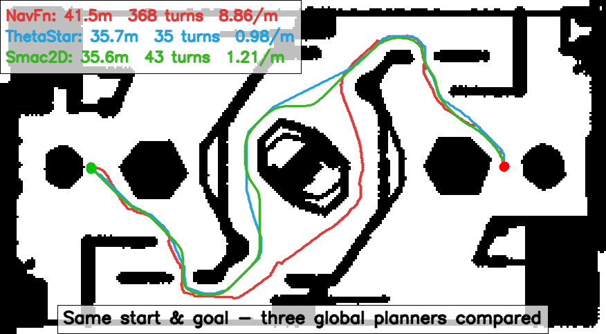

# 导航方向 · 提交报告

> 作业：《2027赛季算法组培训考核作业细则》§3 导航方向
> 提交仓库：https://github.com/gebilaowuxiaoyu123/RMCS_Navigation
> 过程中持续更新；方法见 [任务规划.md](任务规划.md)，数据见 [实验记录.md](实验记录.md)。

---

## 一、任务

用 `rmcs-navigation-deps` 控制哨兵，**换掉现在的全局规划器**（细则禁用 `NavfnPlanner`），
调参做到**无明显卡顿**，实现实际场地**跨场导航**。

验收三问：① 为什么选这个规划器、与现有差异 ② 效果演示 + 代码提交 ③ 调参思路。

---

## 二、验收①：选型 —— 换 `SmacPlannerLattice`（配 `omni` 原语）

### 2.1 三种候选规划器的实测对比

已实测确认现状就是 NavFn（`ros2 param get /planner_server GridBased.plugin`
→ `nav2_navfn_planner::NavfnPlanner`，与细则表述一致）。

同一起终点（`world(0,0)` → `(20,0)`）分别跑三种规划器，测路径质量：

| 规划器 | 长度 | 转折数 | 最大转角 | 转角总和 | **急转(>45°)** |
|---|---|---|---|---|---|
| **NavFn**（现状） | 41.53 m | 368 | **179.8°** | 18303° | **103 次** |
| **ThetaStar** | 35.68 m | 35 | 63.4° | 762° | 1 次 |
| **Smac2D**（已排除） | **35.55 m** | 43 | **10.1°** | **282°** | **0 次** |

> 上表是**三种已实现规划器**的对比，用于说明「转折数少 ≠ 更平滑」。
> **最终选中的 `SmacPlannerLattice` 不在表内** —— 它需要 `lattice_filepath` 才能工作，
> 还没做同起终点的对比测量（待办）。



*同一组起终点（`world(0,0)` → `(20,0)`）：红=NavFn 蓝=ThetaStar 绿=Smac2D。*
*NavFn 锯齿、贴障碍、绕远；ThetaStar 段少但拐得硬；Smac2D 平滑、走通道中间、最短。*

单规划器大图：[NavFn](assets/path_navfn.png) ｜ [ThetaStar](assets/path_theta_star.png) ｜ [Smac2D](assets/path_smac2d.png)

#### ⭐ 关键结论：转折数少 ≠ 更平滑

单看转折数，ThetaStar（35）比 Smac2D（43）**还少**，容易误判。
补测**转角尖锐度**后结论反转：

| | ThetaStar | Smac2D |
|---|---|---|
| 风格 | **少而尖**（硬拐弯 63°） | **多而缓**（最大仅 10°） |
| 急转 | 1 次 | **0 次** |

**原因**：ThetaStar 用视线检测走直线 → 段少但拐得硬；Smac2D 有平滑器 → 拐弯被摊成小角度。
**对跟踪而言，急转才是顿挫来源**（63° 急转必须减速，10° 缓弯可高速通过）。

### 2.2 与现有规划器（NavFn）的差异

| 维度 | NavFn（现状，已禁用） | `SmacPlannerLattice`（选中） |
|---|---|---|
| 路径输出 | 格子级折线，**无平滑**（最大转角 179.8°） | 预计算运动原语拼接（航向数由 lattice 文件决定，官方文件是 16） |
| 搜索方式 | 单分辨率全图 | A\* + 状态栅格（原语提前算好，搜索空间更小） |
| **运动学约束** | 无（纯栅格） | **由 lattice 文件决定** —— 用 `omni` 那份就是全向 |
| 障碍代价 | 隐式（靠膨胀层） | 显式 `cost_penalty` 可调 |
| 是否合规 | ❌ 细则 §3 禁用 | ✅ |

### 2.3 选型理由

**先说要排除的**：

| 候选 | 排除理由 |
|---|---|
| `nav2_navfn_planner::NavfnPlanner` | ❌ 细则 §3 明令禁用（也是仓库原值） |
| `nav2_theta_star_planner::ThetaStarPlanner` | ⚠️ 可用，但实测**「少而尖」**（最大转角 63.4°） |
| `nav2_smac_planner::SmacPlanner2D` | ⚠️ **技术上最合适**（无运动学约束、实测零急转），但**被额外排除** |
| `nav2_smac_planner::SmacPlannerHybrid` | ❌ 只能 `DUBIN` / `REEDS_SHEPP`（阿克曼，有最小转弯半径） |

其中 Hybrid 的不可用是**实测的硬约束**，报错原文：

```
Invalid motion model for Hybrid A*. Please select between Dubin (Ackermann forward only),
Reeds-Shepp (Ackermann forward and back).
```

哨兵是**全向底盘、没有转弯半径**，用带阿克曼约束的规划器等于强行给它加一个转弯半径。

**为什么选 Lattice**：

1. **它是库存里唯一能原生跑全向的合规候选。** Lattice 的运动模型**不写死在插件里**，
   而是写在 `lattice_filepath` 指向的文件里 —— 其 `lattice_metadata.motion_model` 可以是
   `diff` / `omni` / `ackermann`。Nav2 官方就带了 omni 那份：
   `sample_primitives/5cm_resolution/{0.5m,1m}_turning_radius/omni/output.json`
   （`motion_model = "omni"`、`num_of_headings = 16`、144 / 128 条原语）。
2. **显式障碍代价 `cost_penalty`** —— 路径走通道中间，实车少微调。
3. **状态栅格搜索** —— 原语预计算，搜索空间比逐格 A\* 小。

> **一句话**：NavFn 禁用、Smac2D 排除、ThetaStar 弃用、Hybrid 实测只有阿克曼
> ⇒ **只有 Lattice 能靠 `omni` 原语同时满足「合规」与「全向」**。

> ⚠️ **必须显式给 `lattice_filepath`**：默认值是 **`ackermann`** 那份，而且文件真实存在，
> 所以**不报错、静默生效**。实测日志原文：
> `Using motion model: State Lattice. State lattice file: .../0.5m_turning_radius/ackermann/output.json`

> ⚠️ **待解决**：lattice 文件是 5cm 网格、本场代价图是 10cm。Nav2 官方
> `lattice_primitives/README.md`：「**This should be the same as your costmap resolution.**」

### 2.4 代价地图（理解选型的必要背景）

Nav2 代价不是 0/1 两态，而是 **0~254** 分级（源码 `cost_values.hpp`）：

| 代价 | 含义 |
|---|---|
| `254` | 致命（真实障碍） |
| `253` | 内切（机器人中心到这必撞，即 `inscribed_radius` 以内） |
| 1~252 | 膨胀区（离障碍越近代价越高） |
| `0` | 完全自由 |

**膨胀衰减公式**（源码 `inflation_layer.hpp` 的 `computeCost()`）：

$$\text{cost}(d) = \begin{cases} 254 & d = 0 \text{（障碍本身）} \\ 253 & 0 < d \le r_{in} \\ 252 \cdot e^{-k\,(d - r_{in})} & d > r_{in} \end{cases}$$

其中 $k$ = `cost_scaling_factor`，$r_{in}$ = `inscribed_radius`（由 `footprint` 自动算出）。

**方向要记牢**：$k$ **越大** → 衰减越快 → 代价掉得快 → **路径敢贴墙**；
$k$ **越小** → 衰减越慢 → 高代价带越宽 → **路径被推离墙**。

> ⚠️ **`OccupancyGrid.data` 是 `int8[]`**，所以用 `ros2 topic echo` 看代价地图时，
> 超过 127 的值会**显示为负数**：`254 → -2`、`253 → -3`、`255(未知) → -1`。
> 不知道这点会把"致命障碍"误读成"未知"。

**意义**：$f = g + h$ 中，走通道中间（代价 0）比贴墙（代价高）f 更小，
算法自动偏中间 —— 这是"让 f 有区分度"的手段。

---

### 2.5 官方分支参考：竞赛分支选的是 `SmacPlanner2D`

> ⚠️ **这不是本项目的最终选型**。列它有两个用处：
> ① 说明“官方也认为 NavFn 该换掉”；② 它的**参数取值**（`tolerance` / `cost_travel_multiplier` /
> `footprint` / `inflation`）可以当调参起点。
> 而 Smac2D 本身因非技术原因被排除，详见 §2.3。

遍历上游 `Alliance-Algorithm/rmcs-navigation` 全部分支后发现，**2026-04-23 的
`feature/competition-navigation-20260423` 分支用的就是 `SmacPlanner2D`**：

| 参数 | 我们当前（NavFn 基线） | 竞赛分支（Smac2D） |
|---|---|---|
| `plugin` | `nav2_navfn_planner::NavfnPlanner` | **`nav2_smac_planner::SmacPlanner2D`** |
| `tolerance` | 0.5 | 0.25 |
| `cost_travel_multiplier` | — | 6.0 |
| `max_planning_time` | — | 0.2 |
| `downsample_costmap` | — | false |
| global `footprint` | 0.2 方 | **0.2475 方**（= 0.7 对角线，与我们独立发现的 bug 修法一致） |
| global `inflation_radius` / `cost_scaling_factor` | 0.5 / 0.5 | 0.15 / 5.0 |
| `controller_frequency` | 20.0 | 30.0 |
| `xy_goal_tolerance` | 0.1 | 0.2 |

> 说明我们的选型**不是主观判断** —— 队伍自己在竞赛分支上做过同样的选择。
> 我们的实测数据（§2.1）与 `dev/tcd-test`（2026-09-22）的 MPPI 调参（§3.4）
> 共同构成参数依据。

---

## 三、验收③：调参思路

### 3.1 先判断"卡顿"是哪一种

| 类型 | 现象 | 根因 | 怎么测 |
|---|---|---|---|
| 规划卡顿 | 走一半停几秒 | 全局规划慢 | `ros2 topic hz /plan` 看空档 |
| 跟踪卡顿 | 一直在走但一顿一顿 | 路径折线，转折反复降速 | 看 `/cmd_vel` 速度曲线 |

**必须先判断类型再动手**，否则瞎调。

### 3.2 调参顺序（从粗到细，一次只动一个）

| 顺序 | 参数 | 现值 | 作用 | 调过头 |
|---|---|---|---|---|
| 1 | `inflation_radius` | 0.5 | 安全圈大小 | 门洞堵死→无解 |
| 2 | `cost_scaling_factor` | 0.5 | 代价衰减快慢（**越大越敢贴墙**） | 调大→贴墙；调小→过于保守，可能堵死窄道 |
| 3 | `cost_penalty`（Smac2D） | — | 障碍代价权重 | 过大→绕远 |
| 4 | `downsampling_factor`（Smac2D） | — | 降采样倍数 | 过大→路径糙 |
| 5 | `tolerance` | 0.5 | 终点偏差 | 过小→终点无解 |
| 6 | `smoother.w_smooth`/`w_data` | — | 平滑度 | `w_data` 过小→撞障碍 |
| 7 | 重规划频率 | 1.0 Hz | 重规划频率 | 过高→明显卡顿 |

### 3.3 调参记录

> 详细过程与原始输出见 [实验记录.md](实验记录.md) 2026-09-30 / 10-01 各条。

| # | 参数 | 改动 | 原因 | 现象 | 结论 |
|---|---|---|---|---|---|
| 1 | `GridBased.plugin` | `NavfnPlanner` → `SmacPlannerLattice` | 细则禁用 NavFn | 路径由锯齿变为 16 航向折线 | ✅ 保留 |
| 2 | `lattice_filepath` | 官方 demo（5cm/ackermann）→ **自建 10cm omni**（136 条原语） | 官方 demo 分辨率与代价图对不上，且运动模型是阿克曼 | 全向运动可原生表达 | ✅ 保留 |
| 3 | `CostCritic.critical_cost` | 120 → **300** | 源码 `if (cost > critical_cost_) cost += collision_cost_(8e6)`；本车 `CSF=0.5` 使膨胀带代价全落在 **227~252** ⇒ 120 把整条带判成碰撞 | 修前「目标落灰格、车完全不动」 | ✅ **必须 > 252** |
| 4 | `PathAlignCritic.cost_weight` | 0.8 → **5.2** | 0.8 几乎不约束“贴合全局路径”（官方 tcd-test 用 4.5） | 更贴全局路径，治画龙 | ✅ 保留 |
| 5 | `general_goal_checker.xy_goal_tolerance` | 0.1 → **0.25** | 0.1 偏严 ⇒ 到了却判没到 | 减少假失败 | ✅ 保留 |
| 6 | `GridBased.tolerance` | 0.5 → **0.25** | 贴合 SmacPlannerLattice 官方默认 | — | ✅ 保留 |
| 7 | 全局/局部 `footprint` | 0.2 方 / 0.495 方 → 试探对齐后**回退** | 差 2.475 倍是「有缝就想钻」的根因 | 放大全局 footprint 会显著增加 `no valid path` | ⏸ **未验证成功，暂回退** |
| 8 | `cost_scaling_factor` | 0.5 → 试探 1.3 / 1.5 后**回退** | 0.5 让膨胀带几乎全平（实测 227~252） | 与 `critical_cost` 耦合，必须一起改 | ⏸ **未验证成功，暂回退** |
| 9 | `inflation_radius` | 0.5 → 试探 0.28 / 0.2 后**回退** | 想缩小“墙边天价区” | ⚠️ 实测 `local 0.2 < inscribed 0.258` 使膨胀层**退化成二值图**（实测只有 0/99/100，零中间值） | ❌ **必须 > inscribed_radius** |
| 10 | `non_straight_penalty` | `2` → **`2.0`** | 它是 `double`，写成整数会让 `planner_server` 起来即 FATAL ⇒ 整条 motion 栈停在 `unconfigured [1]` | 代价图 / `/plan` 话题全部消失 | ✅ **必须带小数点**（同坑踩了两次） |
| 11 | `rmcs-localization` submodule | `0907786` → **`2a18128`** | 旧版只有 ROS 服务、零 FIFO，而上游这个提交正是 `switch trigger method from rclcpp srv to fifo` | `relocalize ignored: trigger fifo ... is not available` | ✅ 重定位能触发 |
| 12 | `localization.yaml` `initial_world_to_odom.blue` | `t:[20,0,0] q:[0,0,0,1]` → **场地原点** | 旧值是 RMUC 比赛场设定，而地图已是训练场；ICP **只搜 yaw 不搜位置** ⇒ 初值错 20 m 必滑向假解 | `fitness 0.2832` → **0.0361** 通过 | ✅ 配准成功 |
| 13 | `train.lua` `switch_motion_mode` | `"attack"` → **`"normal"`** | `attack` ⇒ `chassis_mode = SPIN_SLOW/FAST` 导致小陀螺自转，且导航接管时模式被强制覆盖、**拨杆关不掉** | 车不再原地自转 | ✅ 保留 |

**从整轮失败尝试里得到的 5 条硬规则**（比参数值本身更值钱）：

1. **`critical_cost` 必须 > 局部代价图最大代价（252）**。本车 `CSF=0.5` 下膨胀带压在 227~252，
   所以原版的 120 会把整条带判成碰撞 ⇒ “目标落灰格车完全不动”。
2. **`inflation_radius` 必须 > footprint 的 `inscribed_radius`**（本车 local 实测 **0.258**
   = 半宽 0.2475 + 默认 `footprint_padding 0.01`）。低于它 ⇒ 膨胀层失效、
   而 `inflation_radius ~ inscribed` 那圈变成“自由空间” ⇒ 有撞墙风险。
   Nav2 会直接报 ERROR：
   `The configured inflation radius (0.200) is smaller than the computed inscribed radius (0.258)...`
3. **`inflation_radius` 还必须 > footprint 的 `circumscribed_radius`**（本车 local 实测 **0.364160**
   = `0.2575 × √2`）。低于它 ⇒ `CostCritic::findCircumscribedCost()` **返回 0**
   ⇒ `possible_collision_cost_ < 1.0` 恒真 ⇒ **每个轨迹点都做完整 footprint 碰撞检查**
   ⇒ CPU 打满、代价图掉频（实测 10→8.13 Hz、5→3.28 Hz）。
   Nav2 报：`[computeCircumscribedCost] The inflation radius (x) is smaller than the circumscribed radius (0.364160) ... This may significantly slow down planning times!`
   ⇒ **`inflation_radius` 至少要 ≥ 0.37**（原版 `32231c4` 就是 0.37）。
4. **`cost_scaling_factor` 必须让膨胀带**边缘**代价落到 `near_collision_cost` 以下**。
   膨胀层公式 `cost(d) = 252·e^(-k(d−r_in))`；本车 `near_collision_cost: 230`，
   而 `CostCritic` 对 `cost ≥ 230` 的点一律加**平的** `critical_cost`（无梯度）。
   - `R=0.37, k=0.5` ⇒ 边缘 `252·e^(-0.056) ≈ 238` ⇒ **仍 > 230 ⇒ 整条带平坦、零梯度**
   - `R=0.37, k=3.0` ⇒ 边缘 `252·e^(-0.336) ≈ 180` ⇒ ✅ 梯度 253 → 180
   ⇒ **`k` 至少 ≥ 1.0，推荐 3.0（Nav2 官方默认）**。
5. **`inflation_radius` 不改变碰撞保护**（致命带宽度由 footprint 的 `inscribed_radius` 决定）。
   想让“墙边不那么贵”，正解是抬 `cost_scaling_factor`，而不是缩 `inflation_radius`。

验证手段：写了个小工具订阅读取代价图并统计代价直方图（`OccupancyGrid` 标度，
内部 253→99 / 254→100）。**梯度正常 = 有中间值；退化成二值图 = 没有。**

### 3.4 已发现的两个切入点

实测后确认两处不一致，列入优先排查：

| 项 | 现状 | 问题 |
|---|---|---|
| 全局 / 局部 `footprint` | 0.2 m 见方 / 0.495 m 见方 | 差 2.5 倍；真实值应为 0.2475（由斜边 0.7 m 换算），全局 0.1 像占位值 |
| `inflation_radius` | 0.5 m | 0.1 m 栅格下仅占 5 格，车宽也占 5 格 → 窄门洞有堵死风险 |
| **`PathAlignCritic` / `PathFollowCritic`** | **0.8 / 3.2** | 管"贴不贴路径"与"抄不抄近道"，是卡顿 / 画龙的主因 |

**判据**：通道可通行 ≈ 宽度 > 车宽 + 2×膨胀 = 0.495 + 1.0 = **1.495 m**。

**第三个切入点的官方数值参照**（上游 `dev/tcd-test`，2026-09-22，
**保留 NavFn、只调 MPPI**）：

| 参数 | 现在 | 官方调后 | 作用 |
|---|---|---|---|
| **`PathAlignCritic.cost_weight`** | 0.8 | **4.5** | 更贴全局路径，治"画龙" |
| **`PathFollowCritic.cost_weight`** | 3.2 | **2.4** | 少抄近道 |
| `PathAlignCritic.trajectory_point_step` | 3 | **2** | 对齐检查更密 |
| `batch_size` | 1400 | **2000** | 采样更密，控制更顺 |
| `prune_distance` | 6.0 | **4.5** | 聚焦近处路径 |
| `temperature` | 0.34 | **0.38** | 探索略增强 |
| `ConstraintCritic.cost_weight` | 5.0 | **5.3** | 更守限速 |
| `CostCritic.near_collision_cost` | 230 | **180** | 放松"接近碰撞"惩罚 |
| `CostCritic.trajectory_point_step` | 1 | **2** | 代价检查变疏，省算力 |
| global `inflation_radius` | 0.5 | **0.22** | 收窄膨胀，少堵门洞 |
| global `cost_scaling_factor` | 0.5 | **0.7** | 略更贴墙 |
| local `inflation_radius` | 0.5 | **0.34** | 同上 |
| global `footprint` | 0.2 方 | **0.18 方** | 向真实值靠拢 |

> 两套官方参考的分工：**`dev/tcd-test` 给 MPPI 调参**（保留 NavFn），
> **`feature/competition-navigation-20260423` 给 Smac2D 参数**（§2.5）。
> 我们的落盘 = 两者的组合。

### 3.5 实测到的"卡顿"证据（✅ 已定位到根因）

持续导航时 `controller_server` 反复报：

```
Control loop missed its desired rate of 20.0000 Hz. Current loop rate is 15.5~15.9 Hz.
```

2026-10-02 复核时发现，**连代价图本身都追不上配置值**：

| 话题 | 配置 | 实测 | 判定 |
|---|---|---|---|
| `/local_costmap/costmap` | 10 Hz | **8.13 Hz** | ⚠ 追不上 |
| `/global_costmap/costmap` | 5 Hz | **3.28 Hz** | ⚠ 追不上 |
| `/plan` | 1.0 Hz（行为树 `RateController`） | 0.974 Hz | ✅ 正常 |
| `/local_map` / `/odom` | 10 Hz | 10.01 / 10.00 Hz | ✅ |

**⇒ 不是"频率配高了"，是"系统过载、追不上配的频率"。** 根因见 §3.6 问题 **#1**。

---

### 3.6 调参期问题全量清单（按根因归类）

把整个调参过程中踩到的问题按**根因**归一遍 —— 比按时间排更有用，
因为**同一类根因会以完全不像同一件事的表象反复出现**。
明细见 [实验记录.md](实验记录.md)；逐条清单见本文 §六。

#### 3.6.1 根因 → 表象对照表

| # | 根因类别 | 具体根因 | 表象 | 处置 |
|---|---|---|---|---|
| **1** | **阈值耦合**<br>（一个参数的合法取值被另一参数决定） | `inflation_radius 0.28` < footprint 的 `circumscribed_radius 0.364160` ⇒ `CostCritic::findCircumscribedCost()` 返回 0 | 控制环掉到 15.5~15.9 Hz；**代价图也追不上（10→8.13 / 5→3.28 Hz）** | 抬到 **≥ 0.37** |
| **2** | 同上 | `cost_scaling_factor 0.5` 让膨胀带代价全压在 **238~253**，**全部 ≥ `near_collision_cost 230`** | 局部轨迹"乱飘 / 画龙" —— 代价值**平坦、零梯度** | 抬到 **3.0** |
| **3** | 同上 | `critical_cost 120` < 局部图最大代价 **252** | **目标落在灰格、车完全不动** | 改成 **300** |
| **4** | 同上 | `inflation_radius 0.2` < `inscribed_radius 0.258` | 膨胀层**退化成二值图**（只有 0/99/100）；墙上多出一圈"自由空间" | 必须 > `inscribed_radius` |
| **5** | **参数"看起来设了、其实没生效"** | **无前缀**参数写在 `static_layer:` 前缀下（`use_maximum` / `lethal_cost_threshold` / `track_unknown_space` / `unknown_cost_value` / `trinary_costmap` / `transform_tolerance`） | 值改了**毫无反应**（实际一直走默认值） | 移到 costmap 级 |
| **6** | 同上 | Lattice 只认固定的一批参数名，写错名 / 写在块外 | **静默忽略**，不报错也不警告 | 用源码逐个核对 |
| **7** | 同上 | `motion_model` / `use_astar` / `use_final_approach_orientation` 是**死键**（Lattice 不声明） | 写了等于没写 | 删除或保留为留档 |
| **8** | 同上 | 不写 `lattice_filepath` | **静默退回阿克曼**那份（文件真实存在，不报错） | 必须写绝对路径 |
| **9** | **类型不匹配** | `double` 写成整数（`non_straight_penalty: 2`） | `planner_server` **FATAL** ⇒ 整条 motion 栈 `unconfigured [1]` ⇒ 代价图 / `/plan` 话题**全消失**（曾误判成"话题丢了几个"） | 写 `2.0` |
| **10** | 同上（反例） | `int` 写成小数（`near_collision_cost` / `cost_power` / `batch_size` / `time_steps` / `width` / `height` …） | 同样 FATAL | 必须写整数 |
| **11** | **跨包"契约"对不上** | `rmcs-navigation` 往 **FIFO** 写，而 `rmcs-localization` submodule 停在**只提供 ROS 服务**的旧版 | `relocalize ignored: trigger fifo ... is not available` | submodule 对齐 `2a18128` |
| **12** | 同上 | `global_map` 由 **Lua 端点**决定，不是 launch 默认值 | 换了端点后"哪里都能走"（挂的是空图） | 换端点先看它的 `global_map` |
| **13** | **算法假设被打破** | ICP **只搜 yaw**、不搜位置 / pitch / roll；且局部图以初值为中心裁 25 m | 初值错 20 m ⇒ 必滑向假解，`fitness 0.2832` 被拒 | 初值改成场地原点 |
| **14** | 同上 | Lattice 的 `grid_resolution` 必须 **== 代价图分辨率**（官方 README 原话） | 5cm 原语配 10cm 代价图 ⇒ 行为不可预期 | 自建 10cm omni 原语 |
| **15** | 同上 | 舵轮运动学是**平面假设**（`vehicle_radius 0.2687`） | 坡道上打滑 / 转角解算失准 | 🔴 **未解决**（见 §3.7.5） |
| **15b** | **功能不在你以为的那条链上** | **上坡根本不走 Nav2** —— 它由 `map/train.lua` 的图边调 `action:blocking_cross_step()` → `SentryClimber` 状态机执行；而**手动点目标绕开了这张图** | 无论 Nav2 参数怎么调，**车都上不去**（`SentryClimber` 全程 `status = 0`，即空闲） | 🔴 **未解决**（见 §3.7.5）；判据：`ros2 topic echo /chassis/climber/status` |
| **16** | **两套数据源不一致** | global 挂 `/map`（离线扫描图）；local 挂 `/local_map`（`rmcs_local_map` 实时） | **全局黑 ≠ 局部黑** | 见 #18 |
| **17** | 同上 | `rmcs_local_map` **只标障碍、不标自由** ⇒ 局部图 **92.7% 是未知** | 局部图**几乎处处"自由"** | 见 #18 |
| **18** | 同上 | #16 + #17 + `track_unknown_space: false`（未知→自由） | **局部规划"敢走"全局图上一团黑的地方**（抽样 151 个全局致命格，**64.2% 在局部图上是 `0`**） | 给 local 加一层订阅 `/map` 的 `StaticLayer` |
| **19** | **环境 / 工具链的"假故障"** | zsh 下 `setup.bash` 静默失效；isolated install 布局让 `build-rmcs` 不可用；`ros2 launch` 崩了也返回 0；`pkill -f` 在 ssh 里会杀掉自己 | 各种"明明照做了却没效果" | 见 §六 #1 / #3 / #35 |
| **20** | 同上 | `ros2 topic info` 的 `Subscription count` 忽 0 忽 5（DDS 发现抖动）；Foxglove 缓存"参考系无效" | 误判"话题没了" / "TF 没发" | 交叉验证 / 断开重连 |
| **21** | **人因 / 流程** | 拨杆是 **toggle**、无状态指示 ⇒ 误拨第二次把 tmux 导航会话杀掉 | "地图老是掉" | 拨杆序列要背牢 |
| **22** | 同上 | 架空测试必然 `Failed to make progress`（`SimpleProgressChecker` 4 s / 0.08 m） | 以为"规划器坏了" | 架空时把 `required_movement_radius` 设 0 |
| **23** | 同上 | 硬件损坏（**烧了一个舵轮**） | 8 个目标 7 个 `Failed to make progress` —— **不能用来判断参数好坏** | 先修硬件 |

#### 3.6.2 补记：上坡不走 Nav2 —— 爬坡链全图（★ 本轮最重要发现）

> 这一条不属于「调参」，但它解释了**为什么调参调不出上坡**。
> 完整版见 [实验记录.md](实验记录.md) 2026-10-02 条。

```
① map/train.lua   Map:connect(kStepBegin, kStepFinal)      ← 【唯一】爬坡入口
       kStepBegin = (2.5, -0.8)   kStepFinal = (2.5, -2.2)   kUnderSlope = (4.7, -2.1)
       ├─ action:cancel_target()                 ← 先取消导航目标
       ├─ action:update_supercap_boost(true)     ← ★ 开超电助推
       ├─ action:blocking_cross_step(yaw, true)  ← ★ 发起爬坡（阻塞）
       └─ action:update_supercap_boost(false)

② action.lua   blocking_cross_step(world_yaw, is_climb)
       api.set_climb_switch(is_climb)      → /rmcs_navigation/request/is_climb
       api.set_climb_direction(world_yaw)  → /rmcs_navigation/request/cross_direction
       while true: status = api.get_climb_status()；1.0 / -1.0 才退出

③ SentryClimber（rmcs-core）—— 边沿触发
       nav_request  = NaN → 有限值     （发起）
       nav_canceled = 有限值 → NaN     （★ 立刻终止当前事件）
       另有【遥控器/键盘入口】：拨杆 UP / 键盘 G 按下 = 上台阶
       上台阶状态机：ALIGN(0.1) → APPROACH(0.2) → DEPLOY(0.3) → DASH(0.4) → RETRACT(0.5)

④ ChassisController 读 /chassis/climber/{direction, speed}
```

**四条「为什么上不去」（按可能性排序）**

| # | 原因 | 依据 |
|---|---|---|
| **A** | **手动点目标绕开了这张图** ⇒ `blocking_cross_step` 从未被调用 ⇒ `SentryClimber` 全程空闲 ⇒ 只有普通 Nav2 在推，而 **Nav2 不知道有坡、也没有「冲坡（dash）」概念** | `Map:connect(kStepBegin, kStepFinal)` 是唯一入口；而 `train.lua` 的 `intent_handler = scheduler:append_task(intent)` **已被注释**（commit `b65155a`，为了能收手动目标） |
| **B** | **爬坡要开超电助推**，手动路径下没人开 | `map/train.lua` 两条边里显式 `update_supercap_boost(true/false)` |
| **C** | **触发是「边沿」**，写回 `NaN` 就**立刻终止** | `sentry_climber.cpp` 源码注释原文：「反之，会立刻取消请求，终止当前事件」 |
| **D** | 每阶段**硬超时**，任一步超时就 `status = -1` | `align.timeout 15s` / `approach_timeout 6s` / `stick_timeout 8s` / `soft_timeout 3s` / `settle_timeout 8s` |

**金钥匙（一条命令分辨是 A/B/C 还是 D）**

```bash
ros2 topic echo /chassis/climber/status
# 0=空闲 | 0.1 ALIGN | 0.2 APPROACH | 0.3 DEPLOY | 0.4 DASH | 0.5 RETRACT
# 0.6 LAND_ALIGN | 0.7 LAND_DASH | 0.75 LAND_SETTLE | 0.8 LAND_SOFT
# 0.9 LAND_FINAL | 0.95 LAND_LEAVE | 1.0=成功 | -1=失败
```

| 观察到的 | 说明 | 去查 |
|---|---|---|
| `status` **一直是 `0`** | **请求从未发出** | 原因 **A / C**（手动导航没经过图边） |
| 走到某一步后变 **`-1`** | 那一步**超时** | 原因 **D**（`sentry.yaml` 里对应的 timeout） |
| 走到 **`1.0`** 但车没上去 | 状态机认为成功 | 机械 / 舵轮 / 坡面实际几何 |
| 拨杆/键盘能触发、导航不能 | 请求链断了 | 原因 **A / B** |

#### 3.6.3 最值钱的 5 条（按可复用性排序）

1. **"参数没生效"永远先怀疑三件事：名字对不对、写在哪一层、类型对不对。**
   本轮 23 条里占了 6 条（#5~#10）。**静默忽略比报错更可怕。**
2. **阈值类参数必须两两对照，不能单看一个值。**
   #1~#4 全是"A 参数的合法取值被 B 参数决定"。只看 `motion.yaml` 永远看不出来 ——
   **必须去源码里找那份"比较"**（本轮是 `findCircumscribedCost()` 里的 `if`）。
3. **跨仓 / 跨包的接口（FIFO / 服务 / 共享内存）出问题，先比版本，再看代码。**
   排查顺序：**谁写 / 谁读 → 接口形态 → 两边版本 → 才谈改代码**（#11）。
4. **配准类算法的"初值"是硬约束。**
   先读源码搞清"哪个量搜、哪个量不搜"，再决定能不能靠调参解决（#13）。
5. **性能问题不要先降频率，先看"是不是有东西把工作量放大了"。**
   本轮是 `possible_collision_cost_ = 0`，把碰撞检查从"偶尔做"变成"每个点都做"，
   放大了上千倍（#1）。**降频率只是掩盖症状。**

---

### 3.7 最后一次调参（草稿 · 🅣 由作者完善）

> 队长要求：参数调整**到此为止**，只留最后一次。
> 本节是**草稿**，3.7.5 一栏「无法实现的原因」由作者本人补。

#### 3.7.1 这一次改什么（一次改完、可整体回滚）

| 次序 | 位置 | 参数 | 现值 | 改为 | 依据 | 预期 |
|---|---|---|---|---|---|---|
| 1 | `local_costmap.inflation_layer` | `inflation_radius` | 0.28 | **0.37** | `0.37 > circumscribed_radius 0.364160`（源码 + 机器人日志实证，§3.3 规则 3） | **代价图频率回到 9.5 Hz 以上** |
| 2 | `local_costmap.inflation_layer` | `cost_scaling_factor` | 0.5 | **3.0** | 带边缘代价 `252·e^(-3×0.112) ≈ 180 < 230` ⇒ 有梯度（规则 4） | 轨迹不再乱飘 |
| 3 | `FollowPath.CostCritic` | `trajectory_point_step` | 1 | **2** | Nav2 官方默认值，立即再省一半算力 | 掉频再降一档 |
| 4 | `local_costmap` | **新增一层** `StaticLayer`（订阅 `/map`） | — | 见 3.7.2 | 全局黑格 → `LETHAL(254)` → `CostCritic::inCollision()` 的 `case LETHAL_OBSTACLE` 直接 `return true` | **不再穿全局黑区** |
| 5 | `local_costmap.ros__parameters` | `use_maximum` | 实为 `false`（死键） | **`true`** | **加第二层 `StaticLayer` 的前置条件**：不加会被 `/map` 整片覆盖掉 `/local_map` 的实时障碍 | 两层取最大 |

> ⚠️ **第 4、5 项要么一起做、要么都不做** —— 只加层不改 `use_maximum` 会比现在更糟。

#### 3.7.2 第 4 项的完整写法

```yaml
local_costmap:
  local_costmap:
    ros__parameters:
      # ★ 新增：必须写在 costmap 级（无前缀），写在 static_layer: 下就是死键
      use_maximum: true
      plugins: [static_layer, static_map, inflation_layer]

      static_layer:                 # 原样保留：/local_map 实时障碍
        plugin: nav2_costmap_2d::StaticLayer
        map_topic: /local_map
        map_subscribe_transient_local: false
        subscribe_to_updates: true

      static_map:                   # ★ 新增：全局静态图
        plugin: nav2_costmap_2d::StaticLayer
        map_topic: /map
        map_subscribe_transient_local: true    # /map 是 latched 话题
        subscribe_to_updates: false
```

> **为什么 world 系的 `/map` 能贴进 `base_link` 的滚动窗口**：
> `StaticLayer::updateCosts()` 有专门的 rolling 分支，会自己做
> `lookupTransform(world ← base_link)` 再逐格投影 —— 依赖重定位提供的 `world→odom` 那条 TF。
> ⇒ **前置条件：重定位必须正常工作**（`fitness < 0.05`）。

#### 3.7.3 验收判据（改完立刻可测）

| # | 判据 | 期望 |
|---|---|---|
| 1 | `ros2 topic hz /local_costmap/costmap` | **≥ 9.5 Hz**（现在 8.13） |
| 2 | `grep 'circumscribed radius' ~/.ros/log` | **不再出现** |
| 3 | `grep 'Control loop missed' ~/.ros/log` | 不再出现 |
| 4 | `tools/costmap_probe.py --topic /local_costmap/costmap` | 取值集合出现**中间值**（1~252），不再只有 0/99/100 |
| 5 | 把目标点设在"全局图黑色区"附近 | 车**不进入**黑色区 |
| 6 | 平地"点两个点能到" | 仍然能到（**不回退**） |

#### 3.7.4 明确**不**碰的（这一轮也不动）

| 项 | 为什么不动 |
|---|---|
| `track_unknown_space` | **必须保持 `false`**。源码：开启后 `footprintCostAtPose()` 取 footprint 各顶点代价的 `max`，`255(未知) > 254(致命)` ⇒ max 恒为 255 ⇒ 走 `NO_INFORMATION` 分支 ⇒ 返回「不碰撞」⇒ **真实致命障碍反被忽略**。而 `/local_map` 有 92.7% 未知 ⇒ 几乎必然命中 |
| `global_costmap` 的任何参数 | 全局路径当前表现正常，动它**没有收益、只有风险** |
| 全局 / 局部 `footprint` 对齐 | 全局抬到 0.2475 会显著增加 `no valid path`（10-01 实测过） |
| 底盘 / 机械 / 坡道 | **不在参数范围内**，见 3.7.5 |

#### 3.7.5 这最后一次调参**不解决**的问题（🅣 作者本人完善「无法实现的原因」）

| 问题 | 想做的 | **无法实现的原因** |
|---|---|---|
| 🔴 **无法稳定上坡**（当前最大问题） | 让车能稳定通过坡道 | **已定位到机制层**：上坡**不走 Nav2**，而是 `map/train.lua` 的图边 → `action:blocking_cross_step()` → `SentryClimber` 状态机；而手动点目标**绕开了这张图** ⇒ 爬坡请求从未发出。**🅣 待补：为什么最终没改回「走图」路线**（时间不够？手动更便于演示？恢复意图调度会连带影响其它功能？） |
| 全局 / 局部 `footprint` 对齐 | 消除「有缝就想钻」 | 🅣 *（待补）* |
| 全局侧 `cost_scaling_factor` | 让全局路径更贴通道中线 | 🅣 *（待补）* |
| 地图与场地的一处出入 | 把没标的那处障碍补进地图 | 🅣 *（待补：位置未标注 / 无原始地图源 / 时间）* |
| 实车演示录屏 | 验收材料 | 🅣 *（待补）* |
| 最终版并入 `RMCS_Test` | 交付 | 🅣 *（待补：与 `dev/zlq-8-5` 的冲突 / 等队长确认）* |
| 上游 `sensor.launch.yaml` 无守卫 include | 给上游提 issue / PR | 🅣 *（待补）* |

---


## 四、验收②：效果演示与提交

### 4.1 进度

| 项 | 状态 |
|---|---|
| 依赖栈 + 环境搭建 | ✅ |
| 基线确认（现用 `NavfnPlanner`） | ✅ |
| 无机器人测试环境（5 节点 `active`） | ✅ |
| 基线跑通（368 转折、`/plan` 0.99 Hz） | ✅ |
| **三种规划器横向实测**（+ 转角尖锐度指标） | ✅ |
| 方案选型论证（数据支撑 + 官方分支佐证） | ✅ |
| 演示套图（3 张单图 + 1 张汇总） | ✅ |
| **真车上车链路摸底**（部署流程 / 触发条件 / 使能条件） | ✅ |
| 基准分支对齐（导航仓切到官方 `dev/zlq-8-5`） | ✅ |
| 规划器落盘（`plugin` + `lattice_filepath`→自建 10cm omni） | ✅ |
| 自建 10cm omni 原语（136 条，与代价图分辨率对齐） | ✅ |
| 真车部署链路跑通（`build-rmcs` / `sync-remote` / `sentry.yaml`） | ✅ |
| **重定位链路打通**（`rmcs-localization` submodule 版本对齐，FIFO 触发生效） | ✅ |
| **重定位配准修正**（`blue` 初值偏 20 m → 改为场地原点） | ✅ |
| **`train.lua` 端点**（含 `relocalize` / 关小陀螺 / 手动点目标） | ✅ |
| **实车「点两个点能到」** | ✅ |
| **调参根因定位**（掉频 / 无梯度 / 死键 / 敢走黑区，四类全部定位到源码级，见 §3.6） | ✅ |
| **「最后一次调参」清单定稿**（§3.7：5 项改动 + 6 条验收判据 + 7 项明确不做） | ✅ |
| 「最后一次调参」执行 | ⏳ |
| 🔴 **「无法稳定上坡」**（当前最大问题，见 §3.7.5） | ❌ **未解决** |
| 调参消除卡顿（长期稳定运行） | ⏳ 部分 |
| 对比录屏 | ⏳ |

### 4.2 演示材料

| 材料 | 状态 |
|---|---|
| `assets/path_navfn.png` | ✅ NavFn 单图（基线） |
| `assets/path_theta_star.png` | ✅ ThetaStar 单图 |
| `assets/path_smac2d.png` | ✅ Smac2D 单图（已排除，留作对比） |
| `assets/path_compare_three.png` | ✅ **三种规划器汇总对比图**（主力材料） |
| `assets/navfn_baseline_raw.txt` | ✅ NavFn 原始输出（823 路径点，可复现） |
| Foxglove 录屏 | ⏳ |

### 4.3 提交信息

| 位置 | 内容 |
|---|---|
| `gebilaowuxiaoyu123/RMCS_Navigation` | 本报告、任务规划、实验记录、配置快照、演示材料 |
| `gebilaowuxiaoyu123/rmcs-navigation` | 代码改动 `config/motion.yaml`（本地分支 `feat/nav-on-zlq8-5`，**基于官方 `dev/zlq-8-5`**） |
| `gebilaowuxiaoyu123/RMCS_Test` | 最终版并入 |

**改动文件**：`rmcs-navigation/config/motion.yaml`（`GridBased.plugin` 及 Smac2D 参数）
—— **真车上只改这一个文件**，详见 [任务规划.md](任务规划.md) §9.5。

---

## 五、进展记录

| 日期 | 进展 |
|---|---|
| 9.22 | 搭环境、确认基线 NavFn、跑通静态栈、取得基线数据（368 转折 / 1.03 ms） |
| 9.28 | 复核静态栈可用（824 点 / `error_code` 0，与 9.22 一致）；固化"静态跑一遍"流程；新认知：**启动约需 20 秒**才全部注册完成 |
| 9.28 | **三种规划器横向实测**：三者都只需改 `plugin:` 一行即可切换；测出 Smac2D **零急转**（最大转角 10.1°），NavFn 有 103 次急转、最大 179.8°；关键认知：**转折数少 ≠ 更平滑** |
| 9.28 | **真车上车链路摸底**：确认是"远程部署"而非遥控（`build-rmcs` → `sync-remote` → `service rmcs`）；摸到**三道隐藏门**（导航由比赛阶段触发 / 底盘使能靠遥控器右拨杆 UP / `global_map` 由 Lua 端点决定）；结论：**真车只需改 `motion.yaml` 一个文件** |
| 9.28 | **找到官方调参参考**：`dev/tcd-test`（9.22）保留 NavFn 调 MPPI，`PathAlignCritic` 0.8→4.5；`feature/competition-navigation-20260423` 已用 `SmacPlanner2D` —— 选型有官方先例 |
| 9.28 | **基准分支对齐**：导航仓切到官方 `dev/zlq-8-5`（比 `main` 新），补回其缺失的 `rmcs_description` 依赖并编译通过 |
| 9.29 | **定位 `base_link` 断链根因**：官方 `sensor.launch.yaml` 末尾**无守卫地** include 了 `rmcs_localization`，而该包在本工作区**从未编译**（`build-rmcs` 因 isolated 布局不可用，编译一直带 `--packages-select`）→ 整个 sensor 栈启动失败 → `point_lio` 未起 → `odom→base_link` 无人发布 |
| 9.29 | **补齐 `rmcs_localization` 并编译通过**（42.6 s）；`ros2 pkg prefix rmcs_localization` 已可解析 —— **`base_link` 断链根因已修** |
| 9.29 | **纠正 TF 树认知**：`odom→base_link` 由 **`point_lio`** 发布（`laserMapping.cpp:169-183`）；`rmcs_localization` 只发 `world→odom`（9.28 那条结论有误，已勘误） |
| 9.29 | **澄清 Foxglove 启动路径**：bridge 只被 `static`/`recall` 两个 launch include，实车入口 `sensor`+`motion` 不带 → 实车导航时需自己起桥；**「Foxglove 没数据」≠「导航没跑」** |
| 9.29 傍晚 | **换 `free` 端点走手动导航**：`sentry.yaml:52` `endpoint: "rmuc"`→`"free"`、`free.lua:116` `global_map`→`"战队"`；该端点的启动入口是**右拨杆 MIDDLE→UP→MIDDLE**（`toggle_train`），会同时做底盘使能 + 起导航栈 + **打开 `/goal_pose` 转发** |
| 9.29 傍晚 | **打通 Foxglove 发目标**：需两条件同时满足 —— ① `switch_topic_forward(true)` 让 C++ 订阅 `/goal_pose`；② Lua 不能抢目标（`action.lua` 每 2 秒重发 `self.target`）。`free.lua` 两者都满足，实测 `/goal_pose` 订阅数 = 3 |
| 9.29 傍晚 | **实车接通 Foxglove，看到地图与全局路径**：实车入口不带 bridge，需自己起（`.script/foxglove` 的命令内容经 `ssh-remote` 执行）；Foxglove 侧需断开重连刷新参考系、手动勾 `/map` |
| 9.29 傍晚 | **定位「原地抖动」根因**：`controller_server: Failed to make progress`（`SimpleProgressChecker` 4 s / 0.08 m）→ `FollowPath` 反复 abort → 行为树重试。**非规划器问题、非掉帧**（`/cmd_vel` 实测 20 Hz / std 0.0011）；odometry ±2 cm 无位移 → 架空时必然发生 |
| 9.29 傍晚 | **`base_link` 断链修复端到端验证**：`rmcs_localization` 经 sync 到机器人后 `/rmcs_localization/*` 话题出现，`/tf` 有 `odom→base_link` |
| 9.30 | **自建 10cm 全向原语**：用官方 `generate_motion_primitives.py` 生成 `lattice/omni_10cm.json`（`omni` / `grid 0.1` / 16 航向 / **136 条**），解决"官方 demo 5cm 与本场代价图 10cm 对不上"的问题 |
| 9.30 | **换 `SmacPlannerLattice` 落盘**，并查出**底盘是舵轮**（`sentry.yaml` → `SteeringWheelController`）—— 直接影响 footprint 与运动模型的选择 |
| 9.30 | **「地图老是掉」真凶**：不是崩溃，是**拨杆 toggle 把 tmux 导航会话杀了**（`api.stop_navigation()` = `tmux kill-session`）；拨杆是 toggle、**无状态指示**，极易误拨第二次 |
| 10.01 | **「话题丢了几个」真凶**：YAML 里浮点写成整数（`non_straight_penalty: 2`）⇒ `planner_server` FATAL ⇒ 整条 motion 栈起不来。**判据：`ros2 lifecycle get` 是 `unconfigured [1]` 而非 `active [3]`** |
| 10.01 下午 | **⚠️ 烧了一个舵轮**；当日 8 个目标 7 个 `Failed to make progress` 系硬件故障所致，**不能用来判断参数好坏**。同时查出「有缝就想钻」根因＝**全局 footprint 0.1 vs 局部 0.2475，差 2.475 倍**（RMCS 原版自带，非我们引入） |
| 10.01 夜 | **与 RMCS 原版逐项对齐**：确认我们相对 `dev/zlq-8-5` 只改了 7 处有效参数；**「有缝就想钻」与「贴墙就怂」都是上游原版的债** |
| 10.01 夜 | **修复重定位链路（接口层）**：`rmcs-localization` submodule 停在 `0907786`（只有 ROS 服务、零 FIFO），而上游 `2a18128` 正是 "switch trigger method from rclcpp srv to fifo" ⇒ 更新 submodule + 重编 ⇒ `relocalize triggered` 出现 |
| 10.01 深夜 | **修复重定位配准（数据层）**：`blue` 初值是 RMUC 比赛场设定（20 m 外 + 转 180°），而地图已是**训练场**；ICP 只搜 yaw 不搜位置 ⇒ 必滑向假解（fitness 0.2832）。改为**与 `red` 一致（场地原点）** ⇒ fitness **0.0361** 通过，`world→odom` 正确发布 |
| 10.01 深夜 | **端点换 `train.lua`**（组长指出 `free.lua` 不开重定位、且已是死代码）；顺手修掉 **`switch_motion_mode("attack")` 导致的小陀螺自转**（ATTACK 模式 ⇒ `chassis_mode = SPIN_SLOW/FAST`，而导航接管时拨杆失效、关不掉） |
| 10.01 深夜 | ✅ **实车「点两个点能到」验收通过** —— 重定位稳定成功（fitness ≈ 0.03，阈值 0.05）、`world→odom` 正确、Foxglove 点目标车能到达 |

---

## 六、踩坑

| # | 问题 | 解决 |
|---|---|---|
| 1 | 误以为要手动 `source` ROS 环境；实为 zsh 下 `setup.bash` 静默失效（用 `BASH_SOURCE[0]` 定位自身，zsh 里为空） | **根本不用 source** —— `.zshrc` 已通过 `~/env_setup.zsh` 配好，`ros2`/`colcon` 直接可用 |
| 2 | `CMake 3.30 or higher is required`（系统 3.28） | 构建时 `PATH=/opt/cmake/bin:$PATH`（4.2.3） |
| 3 | `build-rmcs` 报 install 布局冲突 | 改用 `colcon build --symlink-install` |
| 4 | 父仓库 pin 的 `d57fa1c` 编译不过（缺依赖声明） | 切到上游 `main`（`632962c` 已修复） |
| 5 | 缺 `nav2-mppi-controller`、`py-trees` | `apt-get install` 补齐 |
| 6 | 残留进程 → 节点重复 + 端口占用 | **每次实验前先 pkill 清理** |
| 7 | 静态环境机器人不动 → 导航必然 `Goal failed` | 预期行为；用 `tools/virtual_chassis.py` 让 TF 动起来 |
| 8 | 启动后立刻查节点，误判"节点缺失" | **等约 20 秒**再检查（lifecycle 逐个激活需时间） |
| 9 | 以为"上真车"要改一堆东西 | **只改 `motion.yaml` 一个文件**；`sentry.yaml` 里导航已是启用状态（`AGENTS.md` 也是这么写的） |
| 10 | 以为真车导航开机就起，找不到 `planner_server` | 导航**由比赛阶段信号触发**（`rmuc.lua`：`PREPARATION → 下一阶段`）；手动触发用 `remote-context game_stage started` |
| 11 | `/plan` 有输出但车不动，误判"规划器坏了" | 底盘使能 = **遥控器右拨杆 UP**（`rmuc.lua:27`）；没遥控器时导航速度被 `chassis_controller` 直接忽略 |
| 12 | 换端点后规划器"哪里都能走" | `sensor.launch.yaml` 默认 `global_map := empty`（空图）；只有 `rmuc.lua` 等写死了 `"rmuc"`。**换端点前先看它的 `global_map`** |
| 13 | 改 `/cmd_vel` 的 `angular.z` 没反应 | `navigation.cc` 只取 `linear.x/y`，**`angular.z` 直接丢弃**；转向归 Lua 的 `chassis_mode` / `gimbal_toward` 管 |
| 14 | 真车"卡一下"就以为路径不平滑 | `navigation.cc` 有 **500 ms 看门狗**：`/cmd_vel` 断流超时速度直接归零。**先查掉帧，再查路径** |
| 15 | 官方分支 `dev/zlq-8-5` 编译不过 | 它缺 `rmcs_description` 依赖声明（`main` 在 `632962c` 才补的）；手动补回 `CMakeLists.txt` 3 处 + `package.xml` 1 处 |
| 16 | Foxglove「地图」面板永远"正在等待消息" | Foxglove **Map 面板只支持 `NavSatFix` / `GeoJSON`**（地理坐标），**不支持 `OccupancyGrid`**。看 ROS 地图必须用 **3D 面板**，并在「主题」里**手动勾上 `/map`**（不会自动加载） |
| 17 | Foxglove 连不上 | 地址填了 `localhost`（= 自己电脑）。bridge 在机器人上，要填 `ws://192.168.3.27:8765`；且必须用 **Desktop 版**（网页版是 `https`，连 `ws://` 会被 mixed-content 拦掉） |
| 18 | 远程 / tmux 里 `ros2: command not found` | 默认 shell 是 **zsh**，`source ~/env_setup.bash` 在 zsh 下**静默失效**（同 #1）。远端命令一律用 `bash -lc '...'` 包一层 |
| 19 | 启用 `TfBroadcaster` 后 `rmcs_executor` 崩溃循环（SIGABRT） | 它按通用 `tf_description.hpp` 注册 `/tf`，sentry 用 `sentry_description.hpp`，`JointCollection` 类型不匹配 → **加载期崩溃**。官方所有 sentry 分支都注释它，**不要启用** |
| 20 | 游戏阶段触发导航后什么都没有（无 TF / 无 costmap / 无 `/plan`） | `sensor.launch.yaml` 末尾**无守卫地** include **`rmcs_localization`**，而该包**从未构建**（`ros2 pkg prefix` → `Package not found`）→ `find-pkg-share` 在 launch **描述构建期**失败 → launch 直接退出。**已补编译**（见进展 9.29）。官方此处缺守卫，建议上报 |
| 21 | 以为 `base_link` 断链是 Foxglove 的问题 | Foxglove 只是显示端。`odom→base_link` 的正主是 **`point_lio`**（`laserMapping.cpp:169-183`）；sensor 栈没起来 → `point_lio` 没起 → TF 断在 `base_link`。**先查栈，别查面板** |
| 22 | 以为 `launch_livox:=false` 能绕过缺包 | 那条 include **无守卫**，`find-pkg-share` 是**启动期**求值，与 `launch_livox` 无关 → 一样崩 |
| 23 | 实车导航中 Foxglove 里什么都没有，误判「导航没起」 | bridge **只被 `static`/`recall` include**；实车入口 `sensor`+`motion` 不带 → 需自己跑 `./.script/foxglove`。**「Foxglove 没数据」≠「导航没跑」**，要用 `ros2 topic list` / `tf2_echo` 判 |
| 24 | `foxglove` 命令跑起来不是那个桥 | 被 `/usr/local/bin/foxglove`（另一个程序）**遮蔽**，必须写全路径 `./.script/foxglove` |
| 25 | 把 `192.168.3.210` 当成机器人地址 | 那是**你自己的电脑**（机器人 `last -i` 记录的登录来源）。机器人是 `192.168.3.27`(WiFi) / `192.168.100.1`(有线) |
| 26 | 换了 `endpoint: "free"` 后导航栈起不来 | `free.lua` 只在拨杆序列里 `restart_navigation`；`attach-remote -r` 不会起 | 拨右拨杆 **MIDDLE→UP→MIDDLE** |
| 27 | Foxglove 点目标没反应 | 需两条件同时满足：① 转发未开（`switch_topic_forward`）② Lua 每 2 秒重发 `self.target` 覆盖外部目标 | 用 `free` 端点（开了转发且不跑意图） |
| 28 | 第二个 `foxglove_bridge` 报 `Bind Error`、exit -6 | 同机只能有一个进程监听 8765 | 起桥前 `ss -tlnp \| grep 8765` 确认空 |
| 29 | 重定位永远不启动：`relocalize ignored: trigger fifo /tmp/rmcs-localization/relocalize/trigger is not available` | **两个仓的契约对不上**：`rmcs-navigation` 往 FIFO 写，而 `rmcs-localization` submodule 停在**只有 ROS 服务**的旧版（`0907786`）。上游 `2a18128` 的提交信息正是 `switch trigger method from rclcpp srv to fifo` ⇒ **更新 submodule + 重编**。**排查顺序：谁写/谁读 → 接口形态 → 两边版本 → 才谈改代码** |
| 30 | 重定位触发了但配准必失败（`fitness 0.2832 exceeds accept threshold 0.05`） | `initial_world_to_odom.blue` 是 **RMUC 比赛场**设定（20 m 外 + 转 180°），而地图已是**训练场**。配准**只搜 yaw 不搜位置**，且局部地图以初值为中心裁 25 m ⇒ 初值错 20 m 必滑向假解。**改为与 `red` 一致（场地原点）** ⇒ `fitness 0.0361` 通过 |
| 31 | 拨杆启动导航后车立刻**小陀螺自转**，且**拨杆关不掉** | `train.lua` 的 `switch_motion_mode("attack")` ⇒ `motion.cc` 让 `chassis_mode = SPIN_SLOW/FAST`；而 `chassis_controller` 里**导航接管时模式被强制覆盖**（`if (navigation_enable_control_ && ...) mode = navigation_chassis_behavior_`）⇒ 拨杆/键盘全部失效。**改 lua 用 `normal`**（`ALIGNMENT`，不自转） |
| 32 | `inflation_radius` 调到比 `inscribed_radius` 还小 ⇒ 膨胀层退化 | 实测 `local 0.2 < inscribed 0.258` ⇒ 膨胀层**退化成二值图**（代价图只有 0/99/100，零中间值），且 0.2~0.258 那圈变成「自由空间」有撞墙风险。Nav2 直接报 ERROR。**必须 > `inscribed_radius`**；想「更贴墙」抬 `cost_scaling_factor` |
| 33 | 「目标落灰格、车完全不动」 | `critical_cost` 必须 > 局部图最大代价（**252**）。本车 `CSF=0.5` 使膨胀带代价全落在 227~252，而原版 `critical_cost: 120` ⇒ 整条带被判成碰撞。**改成 300** |
| 34 | ⚠️ **地图与实际场地不符（未解决）** | 队长给的扫描图有**一处后来放了障碍**，但图上仍是自由区。全局代价图**无 obstacle 层** ⇒ 会把路径规划穿过去；局部图挂 `/local_map`（实时障碍）⇒ 车开到跟前被挡，症状**很像**「有缝就想钻」。**位置待标注**（可用 `assets/map_zhandui_grid.png`）。作者判断：**不是前期失败的原因**（前期失败已由舵轮损坏 / 重定位未开 / 配准假解 / `critical_cost` 四点独立解释），但属**确定性隐患**，建议补图 |
| 35 | 起桥「成功」但 8765 没在听 | **`ros2 launch` 节点崩了也返回 exit code 0** | 判断成败要看 `ss -tlnp \| grep 8765` 或日志，不能看退出码 |
| 36 | Foxglove 一直报 `缺少从参考系 <world> 到 <odom> 的变换`，TF 后来补上也不恢复 | 连接时 TF 未到，Foxglove **缓存了「参考系无效」** | **断开重连**（或刷新页面），再重选固定参考系 |
| 37 | `ros2 topic info` 的 Subscription count 忽 0 忽 5 | 本环境 **DDS 发现抖动**（反复出现） | 别信单次读数，用 `foxglove_bridge` 日志交叉验证 |
| 38 | 路径出来了但车**原地抖动** | `SimpleProgressChecker`：4 s 内没移动 0.08 m → `FollowPath` abort → BT 重试 | 架空测试：`required_movement_radius` 设 `0`（关闭检查）；落地测试：先让车在 `world` 原点附近 |
| 39 | YAML 里**浮点写成整数** ⇒ `planner_server` 起来即 FATAL ⇒ 整条 motion 栈停在 `unconfigured [1]`，代价图 / `/plan` / `/trajectories` 话题全消失（曾误判为「话题丢了几个」） | 报错原文：`parameter {GridBased.non_straight_penalty} is of type {double}, setting it to {integer} is not allowed`。**该参数写 `2` 不行、必须 `2.0`**。⚠️ 反例：`CostCritic.near_collision_cost`（unsigned int）/ `cost_power` / `trajectory_point_step` / `batch_size` / `time_steps` / `iteration_count` / `width` / `height` **必须写整数**，加了小数点反而报错。⇒ **改完 yaml 先跑一遍「声明为 double 却写成整数」的扫描脚本**，比从 `unconfigured [1]` 倒查快得多（已踩两次，第二次是收尾时复查 diff 抓到的） |
| 40 | 掉频（`Control loop missed its desired rate`、代价图也只跑出 8.13 / 3.28 Hz）—— 误判成「频率配太高」或「CPU 不够」 | 真因是 **`inflation_radius 0.28` < footprint 的 `circumscribed_radius 0.364160`** ⇒ `CostCritic::findCircumscribedCost()` 返回 0 ⇒ `possible_collision_cost_ < 1.0` 恒真 ⇒ **每个轨迹点都做完整 footprint 检查**（50 点 × 1400 条 × 20 Hz ≈ 140 万次/s）。⚠️ **这与 #32 是两条不同的阈值**（#32 是 `inscribed_radius 0.258`，本条是 `circumscribed_radius 0.364160`），只满足前者不够。**修法：抬到 ≥ 0.37** |
| 41 | 局部轨迹「乱飘 / 画龙」，但局部代价图看起来有障碍、参数也看不出问题 | `cost_scaling_factor 0.5` 让膨胀带内代价全压在 **238~253**，而 `CostCritic` 对 `cost ≥ near_collision_cost(230)` 的点一律加**平的** `critical_cost(300)` ⇒ **整条带无梯度**，MPPI 只剩「在壳里 / 不在壳里」二值信息。**修法：`k` 至少 ≥1.0，推荐 3.0** |
| 42 | 无前缀参数写在 layer 名前缀下 ⇒ **死键**，改了没反应也**不报错** | `Costmap2DROS::init()` 以**无前缀**声明 `use_maximum` / `lethal_cost_threshold` / `track_unknown_space` / `unknown_cost_value` / `trinary_costmap` / `inscribed_obstacle_cost_value`，`StaticLayer::getParameters()` 也无前缀读 ⇒ 全名是 `/local_costmap/local_costmap.use_maximum`，写在 `static_layer:` 下会变成 `...static_layer.use_maximum` ⇒ 读不到。实测：**`use_maximum` 实际一直是 `false`、`lethal_cost_threshold` 实际一直是 `100`**。⚠️ RMCS 上游原版也这么写；**只有一层 static_layer 时等价、察觉不到**，但**加第二层 static_layer 前必须先修**（否则后者会整片覆盖前者） |
| 43 | 局部规划「敢走」全局代价图上一团黑（致命）的地方 | **两套数据源**：global 挂 `/map`（离线扫描图），local 挂 `/local_map`（`rmcs_local_map` 实时）。而 `rmcs_local_map` **只标障碍、不标自由** ⇒ 局部图 **92.7% 是未知**（实测 402×402 里 149749 格 = -1）；叠加 `track_unknown_space: false`（`StaticLayer::interpretValue()` 里 `!track_unknown_space_ && value == unknown_cost_value_` ⇒ `FREE_SPACE`）⇒ **未知全变自由** ⇒ 抽样 151 个全局致命格，**64.2% 在局部图上是 `0`**，`CostCritic` 里 `if (pose_cost < 1.0f) continue;` 直接跳过。**修法：给 local 再加一层 `StaticLayer` 订阅 `/map`**（全局黑格 → `LETHAL(254)` → `case LETHAL_OBSTACLE: return true`） |
| 44 | 以为「把 `track_unknown_space` 改成 `true`」就能让未知不再是自由 | ⚠️ **这样会让 MPPI 彻底无视障碍**。`CostCritic::inCollision()` 里 `case (NO_INFORMATION): return is_tracking_unknown_ ? false : true;`，而 `footprintCostAtPose()` 内部是 `footprint_cost = std::max(footprint_cost, getCost(...))` ⇒ **`255(未知) > 254(致命)` ⇒ max 恒取到 255** ⇒ 走 `NO_INFORMATION` 分支 ⇒ **返回「不碰撞」，真实的 254 致命障碍反被忽略**。而 `/local_map` 有 92.7% 未知 ⇒ 几乎每个 footprint 都命中。**⇒ 必须保持 `false`** |
| 45 | 诊断脚本传到机器人 `/tmp` 后，过一会儿就「不存在」了 | 机器人 **`/tmp` 会被清理**（且重启即清空）⇒ 每次实验前都要重新 `scp`。同类：`tools/costmap_probe.py` 也常被吃掉 |
| 46 | 突然 `ssh remote` 报 `Connection refused` / `scp: Connection closed`，以为网络或 sshd 坏了 | 先看 `uptime` —— 实测两次都是**机器人刚重启或正在重启**（`up 0 min`）。**等 10 秒重试即可**，别去改 ssh 配置 |
| 47 | **「无法稳定上坡」，且怎么调 Nav2 参数都没用** —— 误以为这是导航/MPPI 的问题 | **上坡根本不走 Nav2**。它是一条独立流程：`map/train.lua` 的图边 `Map:connect(kStepBegin, kStepFinal)` → `action:blocking_cross_step()` → `/rmcs_navigation/request/{cross_direction,is_climb}` → `rmcs-core` 的 **`SentryClimber` 状态机** → `/chassis/climber/{direction,speed,status}` → `ChassisController`。而**手动点目标绕开了这张图** ⇒ 请求从未发出 ⇒ `SentryClimber` 全程空闲。**判据：`ros2 topic echo /chassis/climber/status`，一直是 `0` 就说明请求没发**。详见 §3.6.2 |
| 48 | 以为爬坡只能由导航触发 | `SentryClimber` **还有遥控器/键盘入口**：`rise_intent = 拨杆 UP \|\| 键盘 G 按下 \|\| (nav_request && is_climb)`，`land_intent = 拨杆 MIDDLE \|\| 键盘 G 松开 \|\| (nav_request && !is_climb)`。**可用它绕开导航单独验证状态机本身好不好**。另：导航侧触发是**边沿**（`NaN → 有限值`），**写回 `NaN` 会立刻终止**当前事件（源码注释原文：「反之，会立刻取消请求，终止当前事件」） |

---

## 附录：关键参数速查

| 项 | 值 |
|---|---|
| **当前规划器（已落盘）** | `nav2_smac_planner::SmacPlannerLattice`，`lattice_filepath` → 自建 `lattice/omni_10cm.json` |
| ~~原规划器（细则禁用）~~ | ~~`nav2_navfn_planner::NavfnPlanner`~~（基线，已不用） |
| 默认地图 | `rmuc.yaml` → `rmuc-v2.png`，292×161 px @ 0.1 m ≈ 29.2×16.1 m |
| **验收用图** | `战队.yaml` → `战队.png`，**343×110 px @ 0.1 m ≈ 34.3×11.0 m**，origin `[-10.0, -4.0]` |
| 全局 / 局部 footprint | 0.2 m / 0.495 m 见方（⚠️ **不一致**，真车应统一为 0.2475；未修） |
| 膨胀半径 | 全局 0.4 m / 局部 **0.28 m**（⚠️ 局部需 ≥ **0.37**，见 §3.3 规则 3） |
| 🔴 **local `inscribed_radius`** | **0.258**（= 半宽 0.2475 + `footprint_padding 0.01`）—— `inflation_radius` 的**下限 1** |
| 🔴 **local `circumscribed_radius`** | **0.364160**（= 0.2575 × √2）—— `inflation_radius` 的**下限 2**（破它 ⇒ 逐点 footprint 检查 ⇒ 掉频） |
| 局部规划器 | `MPPIController`，`motion_model: Omni` |
| `near_collision_cost` | 230 —— 膨胀带边缘代价必须**低于它**才有梯度 |
| `critical_cost` | 300.0 —— 必须 **> 252**（局部图最大代价） |
| ⚠️ 无前缀参数 | `use_maximum` / `lethal_cost_threshold` / `track_unknown_space` / `unknown_cost_value` / `trinary_costmap` / `transform_tolerance` **必须写在 costmap 级**，写在 `static_layer:` 下是死键（见 §六 #42） |
| 重规划频率 | 1.0 Hz（行为树 `RateController`） |
| 目标容差 | `xy_goal_tolerance: 0.1`（实车建议 0.25） |
| 真车远端 | `remote` = `192.168.3.27:2022`（root），重启用 `service rmcs` |
| 真车地图来源 | Lua 端点 `rmuc.lua` → `global_map = "rmuc"`（**现场要改成 `战队`**） |
| 实车规划器（已验证） | `nav2_smac_planner::SmacPlanner2D` + `nav2_mppi_controller::MPPIController`，`lifecycle` 全 `active [3]` |
| Foxglove | `ws://192.168.3.27:8765`（Desktop 版 + 3D 面板 + 手动勾 `/map`） |
| `world→odom` 来源 | `sensor.launch.yaml` 的**无条件**静态 TF；`rmcs_localization` 重定位成功后接管 |
| `odom→base_link` 来源 | **`point_lio`**（`laserMapping.cpp:169-183`；`mid360.yaml` `tf_send_en: true`） |
| `rmcs_localization` | **必须编译**，否则 `sensor.launch.yaml` 必崩（9.29 已补编译；`map_path` 指向机器人本地 pcd） |
| Foxglove 桥所在入口 | 只有 `static.launch.yaml` / `recall.launch.yaml`；**实车入口 `sensor`+`motion` 不带** |
| `free` 手动端点 | 拨杆 MIDDLE→UP→MIDDLE 启动；自动开 `/goal_pose` 转发且不跑自主意图 |
| 起 Foxglove 桥 | 实车入口不带 → 用 `ssh-remote "bash -lc 'source ~/env_setup.bash && ros2 launch foxglove_bridge foxglove_bridge_launch.xml port:=8765'"`；⚠️ `ros2 launch` 崩了也返回 0 |
| 进度检查（致抖动） | `SimpleProgressChecker`：`movement_time_allowance: 4.0` / `required_movement_radius: 0.08` → 架空时必失败，设 `0` 可关 |
| `free.lua` 无重定位 | 没有 `relocalize()`（`train.lua`/`mock.lua` 有）→ `world→odom` 是静态恒等，世界坐标 = 里程计起点 |
| 看哨兵硬件状态 | `remote-status` |
| 底盘使能 | `enable_control` = 遥控器右拨杆 UP |
| `/cmd_vel` 看门狗 | 500 ms 断流即归零 |
| 速度量纲 | m/s（底盘速度 ÷ 轮半径 = 轮角速度） |
