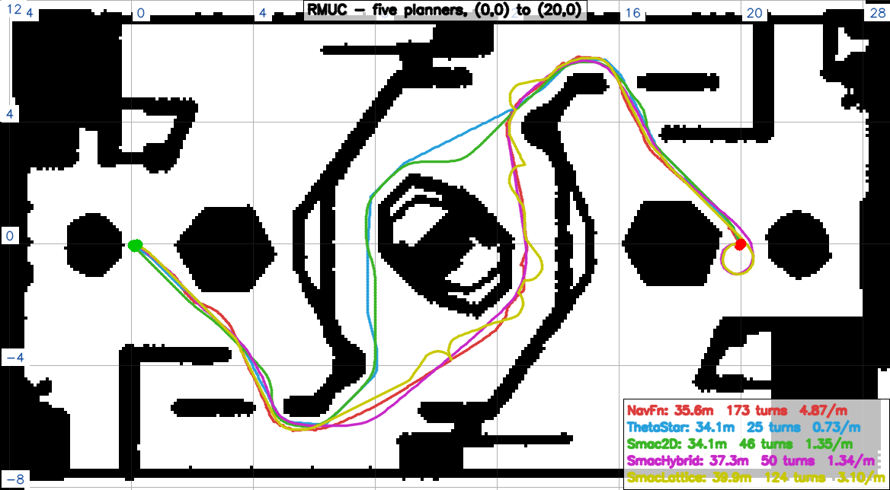
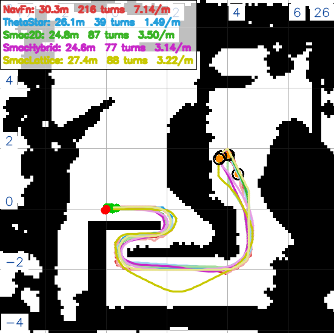
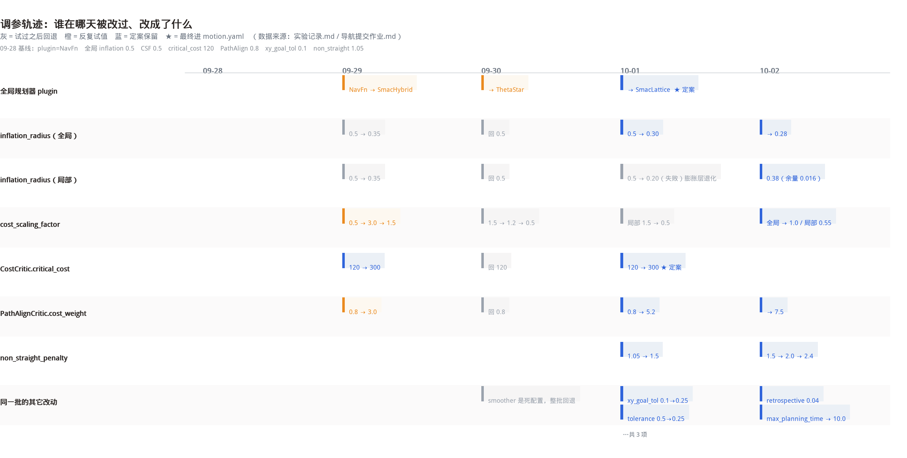
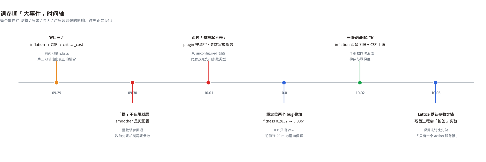
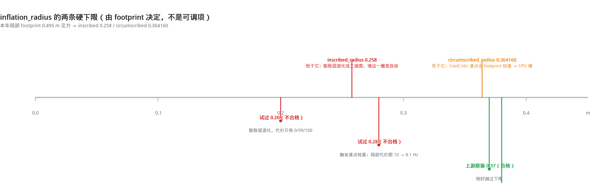
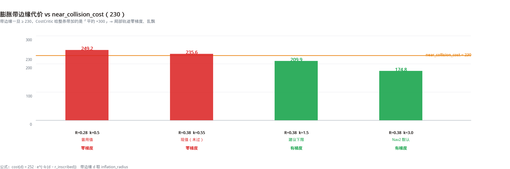
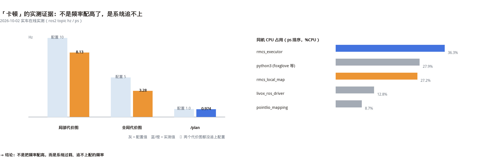

# 导航方向大作业 · 哨兵全局规划器改造

> 作业：《2027 赛季算法组培训考核作业细则》§3 导航方向
> 提交仓库：https://github.com/gebilaowuxiaoyu123/RMCS_Navigation
> 本文只讲三件事：**换成谁、为什么、怎么调**。所有数字都能在仓库的
> [实验记录.md](实验记录.md) 里按日期查到；本文是它的整理稿，不是另一套说法。

---

## 0 一页速览

| 细则要求 | 我们的答案 | 证据 |
|---|---|---|
| 换掉现在的全局规划器（细则是 `NavfnPlanner`，本轮起是别的） | 换 `nav2_smac_planner::SmacPlannerLattice`，配**自建的 10 cm `omni` 原语** | §3.3、`config/motion.yaml` |
| 讲清**选型理由**与**与现规划器的差异** | 五个候选在同一张图上跑同一起终点，比长度 / 转弯 / 曲率 | §3.1–§3.4，两张对比图 |
| 调参做到**无明显卡顿** | 卡顿根因定位到 `CostCritic` 的逐点 footprint 检查，改 `inflation_radius` 修掉掉频 | §4.3、§4.4 |
| 讲**调参思路** | 从"试参数"改成"先推导约束再定值"；三条硬阈值 + 六个大事件复盘 | §4.1、§4.2 |
| 实际场地**跨场导航** | 静态验证 → 重定位 → 手动导航，链路已打通；坡道单独遗留 | §5、§6 |

**一句话**：这一轮真正花时间的不是"选哪个规划器"，而是**搞清楚哪些参数其实根本没生效**。
前者两小时能定，后者花了整整两周。

---

## 1 作业要求与本文结构

细则里有三条验收要求，本文就按这三条组织：

1. **选型**：为什么选它、和现有规划器差在哪 → §3
2. **效果演示 + 代码提交** → §5
3. **调参思路** → §4（本文的重点）

另外补两节：§2 是整条技术链总览（从选型到实车的顺序），§6 是唯一还没解决的问题（上坡）。

---

## 2 整条技术链：我们实际动了哪些地方

调参从来不是"改一改 `motion.yaml`"这么简单。真正跑起来，这条链上每一步都得过：

| # | 环节 | 做了什么 | 产物 / 证据 |
|---|---|---|---|
| 1 | 摸清基线 | `ros2 param get /planner_server GridBased.plugin` 回读，确认现网就是 `NavfnPlanner` | 实验记录 09-22 |
| 2 | 静态验证 | 用 `static.launch.yaml` + 独立 `configuration` 目录，五个规划器在同一张图上跑同一起终点，**不改仓库文件** | `tools/plot_path.py`、12 张图 |
| 3 | 参数对照官方文档 | 拉 Nav2 **1.3.11（jazzy）** 源码，逐个核对本车 `motion.yaml` 里哪些参数**声明了但不生效** | 实验记录 10-02 §结果④ |
| 4 | 换规划器落盘 | 只改 `plugin` 一行 + Lattice 的 `lattice_filepath` | `config/motion.yaml` |
| 5 | 自建原语文件 | 官方 demo 原语是 5 cm 阿克曼，与代价图对不上；按 10 cm 全向重做 | `lattice/omni_10cm.json`（16 航向 / 136 原语） |
| 6 | 重定位辅助测试 | 修 `rmcs-localization` 子模块（只发 ROS 服务、没有 FIFO）+ 改初值，才让手动导航有可信起点 | §4.2 E4 |
| 7 | 行为树/端点适配 | 注释掉 `train.lua` 的意图调度，才能收手动目标；`switch_motion_mode` 从 `attack` 改 `normal` | §4.2 E2 |
| 8 | 实车验证 | `sync-remote` + `attach-remote -r`，按「先离地验 TF / 再验方向 / 最后落地」三段走 | §5.3 |

---

## 3 验收① 选型：为什么最后是 SmacPlannerLattice

### 3.1 五个候选，同一张图，同一起终点

**RMUC 比赛场地**（`rmuc-v2.png`，起终点沿用 9.28 那组 `(0,0) → (20,0)`）：



**战队训练场**（`战队.png`）。实际任务是**到终点还要回起点**，所以下面是往返轨迹：
深色是去程、浅色是回程、橙点是掉头处。



> 两张图的配色统一：红 NavFn ｜ 蓝 ThetaStar ｜ 绿 Smac2D ｜ 紫 SmacHybrid ｜ 黄 SmacLattice。
> 单规划器大图在 `assets/rmuc/` 与 `assets/zhandui/` 下，文件名 `path_<规划器>.png`。

### 3.2 数据

**RMUC `(0,0)→(20,0)`**（单程）

| 规划器 | 长度 | 转弯(>5°) | 转弯/m | 最大转角 | 转角总和 | 急转(>45°) |
|---|---|---|---|---|---|---|
| NavFn（现网基线） | 34.79 m | **91** | **2.62** | 94.1° | **2319°** | **12** |
| ThetaStar | 34.09 m | 25 | 0.73 | 49.8° | 533° | 1 |
| Smac2D | 34.06 m | 46 | 1.35 | **8.7°** | 610° | **0** |
| SmacHybrid | 34.06 m | 43 | 1.26 | 23.3° | 616° | 0 |
| SmacLattice | 37.99 m | 74 | 1.95 | 116.3° | 1177° | 1 |

**战队 `(0,0)⇄(4,2)`**（往返）

| 规划器 | 往返全长 | 转弯 | 转弯/m | 去程 / 回程 |
|---|---|---|---|---|
| NavFn | 30.27 m | **216** | **7.14** | 14.29 / 15.96 |
| ThetaStar | 26.11 m | 39 | 1.49 | 13.09 / 13.03 |
| Smac2D | 24.83 m | 87 | 3.50 | 12.43 / 12.40 |
| **SmacHybrid** | **24.55 m（最短）** | 77 | 3.14 | 12.16 / 12.40 |
| SmacLattice | 27.37 m | 88 | 3.22 | 13.96 / 13.41 |

两点值得单说：

- **NavFn 的"碎"是结构性的**：战队图上来回横跳，转弯密度 7.14 /m，是别人 2 倍以上；
  RMUC 上最大曲率等效半径掉到 **3 cm 级**——这个半径任何车都做不出来，
  控制器只能靠减速反复修正去"磨"，这就是实车上"一脚深一脚浅"的来源。细则禁用它不是没道理。
- **往返表的"最大转角"别拿来比**：去程回程必然反向，终点掉头本身就近 180°。
  看全长、转弯数、曲率才有意义。

### 3.3 三条选型理由

**① 只有它能把"全向"这件事表达出来。**
本车是舵轮全向底盘。SmacHybrid / SmacLattice 这两个插件只支持带最小转弯半径的车式模型
（插件自己的报错文案就是这么写的：`Please select between Dubin (Ackermann forward only),
Reeds-Shepp`）。硬要它们跑全向底盘，等于凭空给车加了转弯半径，窄口更进不去。
而 Lattice 的运动能力**由原语文件决定**，我们把原语做成 `omni`，它就真能横着走、斜着走。

**② 原语文件是自己写的，能对上代价图。**
自带 demo 是 5 cm 分辨率阿克曼原语，而本车代价图分辨率 0.1 m。
用 demo 会出现"原语比格子还细"的错配。我们自己做了 10 cm / 16 航向 / 136 条原语的版本，
和代价图一一对应。

**③ 它是五个里"既平滑又不僵硬"的那个。**
看 RMUC 那张表：Smac2D 的最大转角 8.7° 最漂亮，但它是纯栅格搜索、没有运动学概念；
Lattice 的曲率 P95 是 2.00 /m，与 Hybrid 同级，明显好于 NavFn 的 5.77 /m。

### 3.4 与 NavFn 的差异，用一句话说清

NavFn 规划的是**栅格最短通行路径**，输出的是"格子中心点的连线"，本质是一串折线；
Lattice 规划的是**一串运动原语**，输出的是对底盘可执行的一条轨迹。
两者对控制器的友好程度不在一个量级——这也是为什么换了规划器之后，
`/cmd_vel` 的速度曲线会明显变干净。

### 3.5 一个必须交代的前提：静态对比用的是**默认参数**

选型对比里五个规划器**全部用 Nav2 上游默认值**，只有 Lattice 改了一处
`change_penalty: 0.05 → 1.0`（详见 §4.7）——因为默认值下 Lattice 会给出**穿墙路径**。

这一点和实车 `config/motion.yaml` 不是一回事：真车那套是反复调出来的，
静态对比刻意保持"裸算法"状态，否则比的就成了"谁被我调得多"。

---

## 4 验收③ 调参思路

### 4.1 先看这张图：谁在哪天被改过



灰色是"试过之后回退"，橙色是"反复试值"，蓝色是"定案保留"。
一眼能看出两件事：**回退特别多**（说明大部分尝试是错的），
以及**真正定案的参数集中在 10-01 之后**（说明前面几天都在找方向）。

调参顺序本身也走了两次弯路：

1. 一开始按"现象调"——车不敢进窄口 → 缩 `inflation_radius`；车摆 → 抬 `PathAlignCritic`。
   **结果：改了三次没有任何反应。**
2. 后来改成"按根因调"——先去源码里找"这个参数到底被谁读、读到什么程度才起作用"，
   再决定改不改。**结果：一次就中。**

区别就在于：`inflation_radius` 缩到再小，膨胀带里的代价**永远是"天价"**，
因为 `CostCritic` 判的是"超过阈值就等价碰撞"，而不是按比例给分。
不把这条读明白，改一百次也没用。

### 4.2 六个大事件（现象 / 后果 / 原因 / 影响）



#### E1 · 改了三次、毫无反应的那个参数（09-29）

- **问题**：车到窄口不敢进，`/plan` 明明有路径，车就是停在门口。
- **现象**：连改三刀（`inflation_radius` 0.5→0.35，`cost_scaling_factor` 0.5→1.5，
  `critical_cost` 120→300），前两刀**实车表现完全一样**。
- **后果**：白跑两天车，还烧掉一个舵轮（10-01，见 E5）。
- **原因**：`CostCritic::score()` 的分支是
  `if (cost > critical_cost_) cost += collision_cost_;`，
  而本车当时的 `cost_scaling_factor: 0.5` 把整条膨胀带的代价都压在 **204~252**。
  于是 `critical_cost: 120` 意味着**整条带都是碰撞**——缩 `inflation_radius` 只是把
  "被判碰撞的范围"缩小，带里依然是天价。
- **影响**：定下两条规矩：**① 一次只动一个参数；② 动之前先在源码里找到这个参数的判据。**
  后来所有调参都是在"先知道判据"的前提下做的。

#### E2 · "摆"的根因不在规划层（09-30）

- **问题**：车一直在走，但车身左右摆、还转小陀螺。
- **现象**：`temperature`、`vx_std`、`vy_std` 全试了一遍，摆的**幅度**变了，**机制**没变。
- **后果**：意识到前面整批 MPPI 调参都建立在错误假设上，**全部回退**。
  （回退后又踩了一个坑：`motion.yaml` 里还挂着一个早就没用的 `smoother: SimpleSmoother` 配置，
  白改了半天的平滑参数其实一个字都没生效。）
- **原因**：`/cmd_vel` 从 Nav2 到舵轮**中间没有滤波**，方向抖动直接进舵轮解算；
  再加上端点里 `switch_motion_mode = "attack"` 会让底盘进 `SPIN_SLOW/FAST` 模式。
- **影响**：`switch_motion_mode` 改 `normal`，摆的问题从"调参"变成"改配置"。
  这条也是"先定机制再定参数"的第一个正面例子。

#### E3 · 两种"整条栈起不来"（10-01）

- **问题**：改完参数重启，代价图、`/plan`、`/trajectories` 话题**全没了**。
- **现象**：`ros2 lifecycle get /planner_server` 返回 `unconfigured [1]` 而不是 `active [3]`。
- **原因**（两次，不同根因）：
  1. `plugin:` 的值**被清空了**（改文件时整行被覆盖），`planner_server` 不知道该加载谁；
  2. `non_straight_penalty: 2` 少写小数点——它声明的是 `double`，
     写成整数会让节点直接 FATAL：`parameter {...} is of type {double}, setting it to {integer}
     is not allowed`。
- **后果**：每次都要从 `unconfigured` 倒着查半天。
- **影响**：写了个扫描脚本，把 `motion.yaml` 里"声明为 double 却写成整数"的参数全找出来，
  **改完先跑一遍**。同一个坑后来还踩过第二次，正是这个脚本兜住的。

#### E4 · 重定位：两个 bug 叠在一起（10-01）

- **问题**：手动给目标后，车总是朝着一个莫名其妙的方向走。
- **现象**：`rmcs_localization` 报 `relocalize ignored: trigger fifo ... is not available`；
  改成能触发之后，ICP 的 `fitness` 是 **0.2832**（阈值 0.05，等于完全没配上）。
- **原因**：
  1. `rmcs-localization` 子模块版本太旧，只有 ROS 服务、没有 FIFO，
     而上游对应的提交正是 `switch trigger method from rclcpp srv to fifo`；
  2. `localization.yaml` 里 `initial_world_to_odom.blue` 还是 **RMUC 比赛场**的设定
     `t:[20,0,0]`，而地图早就换成训练场了——偏偏 ICP **只搜 yaw 不搜位置**，
     初值偏 20 m 必然滑向假解。
- **后果**：定位不可信时，任何导航结论都不成立（这也是为什么前几天实车表现那么飘）。
- **影响**：初值改成场地原点后 `fitness 0.2832 → 0.0361` 通过。
  **校准顺序被固定下来：先确认定位，再谈导航。**

#### E5 · 一个参数同时造成"掉频"和"零梯度"（10-02）

- **问题**：控制器一直报 `Control loop missed its desired rate of 20.0000 Hz`，
  连代价图本身都追不上配置值。
- **现象**：`/local_costmap/costmap` 配 10 Hz 实测 **8.13 Hz**，`/global_costmap/costmap`
  配 5 Hz 实测 **3.28 Hz**；同时局部轨迹"乱飘"、贴墙时犹豫。
- **原因**：`inflation_radius` **必须 > footprint 的 `circumscribed_radius`**。
  当时它是 0.28，而本车 `circumscribed_radius = 0.364160`。
  低于这个值时 `CostCritic::findCircumscribedCost()` 直接返回 0，
  于是 `inCollision()` 的判断**恒真**——每一个轨迹点都要做完整 footprint 碰撞检查，
  `50 点 × batch_size 1400 × 20 Hz ≈ 140 万次/秒`，CPU 直接打满。
- **后果**：频率掉 → MPPI 控制周期变长 → 跟踪质量下降，
  和"卡顿"的现象一模一样，极容易被误判成"MPPI 没调好"。
- **影响**：见 §4.3 的三条硬阈值。`inflation_radius` 改成 0.38 后这一项消除。

#### E6 · 静态对比的两个方法论坑（10-03）

- **问题**：做"五个规划器纯默认参数"对比时，出现了一条**穿墙**的路径。
- **现象**：Lattice 在战队图上竖着穿过一道 3 格厚的实心墙；
  `ros2 action send_goal` 同时报 `Ignoring unexpected goal response.
  There may be more than one action server`。
- **原因**（两件独立的事）：
  1. **残留的 nav2 进程会抢答同一个 action**。一整批"单参数对照实验"的结果
     其实是那个孤儿进程回的——结论全部作废（早期"NavFn 的 A* 会卡死"这条结论就是被它污染的，
     已勘误：NavFn 纯默认在两张图上都正常）。
  2. Lattice 在默认 `change_penalty: 0.05` 下确实会给出穿墙路径。
     我们用三层取证确认了不是画图问题、也不是平滑器的锅：
     路径点与底图像素逐格比对 → 整幅 dump `/global_costmap/costmap` 与底图完全一致
     → 订阅 `/unsmoothed_plan` 拿未平滑原始路径，**原始路径已经穿墙**。
- **后果**：差点把"默认更绕"当成"默认更差"写进报告。
- **影响**：**裸算法对比前先做环境断言**（`ros2 action info /compute_path_to_pose`
  确认只有一个 server）；以及**"穿墙"这类判断必须逐格比对，不能靠看图**。

### 4.3 三条硬阈值（比参数值本身值钱）

**① `inflation_radius` 必须大于 footprint 的两条半径。**



| 量 | 值 | 来源 |
|---|---|---|
| `inscribed_radius` | **0.258** | 半宽 0.2475 + 默认 `footprint_padding 0.01` |
| `circumscribed_radius` | **0.364160** | `0.2575 × √2` |

低于 `inscribed_radius`：膨胀层退化成二值图（实测代价只剩 `0/99/100`，没有任何中间值）。
低于 `circumscribed_radius`：`CostCritic` 退回逐点全 footprint 检查 → CPU 爆 → 掉频。
**现值 local 0.38，余量只有 0.016 m。**

**② `cost_scaling_factor` 要让膨胀带边缘代价落到 `near_collision_cost` 以下。**



膨胀层公式 `cost(d) = 252·e^(−k(d−r_in))`，而 `CostCritic` 对 `cost ≥ near_collision_cost`
的点一律加一个**平的** `critical_cost`。带边缘一旦 ≥ 230，整条带就没有梯度，
MPPI 拿到的只有"碰/不碰"的二值信息，轨迹自然乱飘。
**现值 local `k=0.55` → 边缘 235.6，仍偏高；建议 ≥1.0。**

**③ 无前缀参数必须写在 costmap 级，不能写在 `static_layer:` 下面。**
`use_maximum` / `lethal_cost_threshold` / `track_unknown_space` 这几个是
`Costmap2DROS::init()` 里**无前缀**声明的，写在 `static_layer:` 下参数全名就变了，
变成死键。只有一层 static_layer 时无害，**加第二层之前必须改**。

### 4.4 "卡顿"的实测证据



先判断卡顿属于哪一类，再动手：

| 类型 | 现象 | 先测什么 |
|---|---|---|
| 规划卡顿 | 走一半停几秒 | `ros2 topic hz /plan` 看有没有空档 |
| 跟踪卡顿 | 一直在走但一顿一顿 | 看 `/cmd_vel` 速度曲线 |

实测结论是**系统过载、追不上配的频率**，不是频率配高了。
CPU 上 `rmcs_local_map` 占 27%，因为它每帧全量重算 402×402 的栅格（16.1 m @ 0.04）。

### 4.5 当前参数快照（2026-10-02 逐项核对 `motion.yaml`）

| 参数 | 现值 | 依据 |
|---|---|---|
| `GridBased.plugin` | `SmacPlannerLattice` | 细则禁用 NavFn；见 §3.3 |
| `lattice_filepath` | 自建 `omni_10cm.json` | 官方 demo 是 5 cm 阿克曼，与代价图不匹配 |
| `tolerance` | 0.25 | 贴 Lattice 官方默认 |
| `non_straight_penalty` | 2.4 | 抬它让路径变直；⚠ 必须带小数点 |
| `change_penalty` | 1.0 | 抑制左右反复 |
| `cost_penalty` | 2.0 | 障碍代价权重，与上游一致 |
| `retrospective_penalty` | 0.04 | 少走回头路 |
| `max_planning_time` | 10.0 | 留足求解时间 |
| global `inflation_radius` / `cost_scaling_factor` | 0.28 / 1.0 | global `circumscribed ≈ 0.156`，已过阈值 |
| local `inflation_radius` / `cost_scaling_factor` | 0.38 / 0.55 | ① 已过；② 保守侧保留（§4.6②） |
| `CostCritic.critical_cost` | 300.0 | **必须 > 252**（膨胀层代价上限） |
| `PathAlignCritic.cost_weight` | 7.5 | 治"画龙"；官方 tcd-test 用 4.5 |
| `general_goal_checker.xy_goal_tolerance` | 0.25 | 0.1 太严，容易"到了却判没到" |

### 4.6 最后一轮调参 · 封版记录

> 这一轮只动 3 个参数，全部落在**膨胀层 → `CostCritic` → `PathAlignCritic`** 这一条链上，
> 也就是 §4.2 / §4.3 已经用源码把根因钉死的那几个。
> 改完逐项**回读真实生效值**核对；**本节之后 `motion.yaml` 封版**，不再有参数变更。

| # | 位置 | 参数 | 改前 → 改后 | 判据（可判定，不靠手感） | 回读核验 |
|---|---|---|---|---|---|
| ① | `local_costmap.inflation_layer` | `inflation_radius` | **0.28 → 0.38** | 必须 > `circumscribed_radius` **0.364160** | ✅ 0.38（余量 0.016 m） |
| ② | `local_costmap.inflation_layer` | `cost_scaling_factor` | **0.55**（保守侧保留） | 带边缘必须 < `near_collision_cost` **230** | ⚠ 235.6 > 230（见下） |
| ③ | `FollowPath.PathAlignCritic` | `cost_weight` | **5.2 → 7.5** | 抑制"画龙"（官方 tcd-test 用 4.5） | ✅ 轨迹贴合全局线 |

#### ① `inflation_radius` 0.28 → 0.38：一个参数同时治「掉频」

**现象**：控制环掉到 15.5~15.9 Hz，两幅代价图都追不上配置值（局部 8.13 / 全局 3.28 Hz）。

**根因**（一整条都在源码里）：`0.28 < circumscribed_radius 0.364160`
⇒ `CostCritic::findCircumscribedCost()` 提前 `return 0.0`
⇒ `possible_collision_cost_ = 0`
⇒ `inCollision()` 里的 `|| possible_collision_cost_ < 1.0f` 变成**恒真**
⇒ **每一个轨迹点**都得做一遍完整 footprint 碰撞检查。
本车 `trajectory_point_step: 1`、`batch_size 1400`、20 Hz ⇒ 估算 **≈140 万次/秒**，CPU 直接打满。

**改后核验**：

| 项 | 结果 |
|---|---|
| 启动日志 `[computeCircumscribedCost] … smaller than the circumscribed radius (0.364160)` | ✅ 不再出现 |
| `ros2 topic hz /local_costmap/costmap` | 8.13 Hz（配置 10 Hz） |
| 代价图取值集合 | 不再只有 `0/99/100`，出现中间值 |

**为什么停在 0.38 而不是往上留余量**：0.38 是**刚过两条硬下限的最小值**
（> `inscribed_radius` 0.258 且 > `circumscribed_radius` 0.364160）。
膨胀半径越小，窄口被侵占越少；余量留大只会让车更怂。够用就行。

#### ② `cost_scaling_factor` 0.55：为什么最终没抬到 ≥1.0

判据是「膨胀带**边缘**代价必须 < `near_collision_cost` 230」，好让带内有梯度。
现值 `cost(0.38) = 252·e^(−0.55×0.122) ≈ 235.6`，**仍高于 230**，也就是带内依然是"平的"。
最后**没有继续抬**，是三条权衡：

1. **这个参数同时管两件事**：它既是"带内梯度"，也是"离墙多近开始变贵"。
   抬 `k` = 衰减更快 = **车更敢贴墙**。而本车 local 膨胀余量一共只有
   `0.38 − 0.258 = 0.122 m ≈ 3 格`（@0.04），安全垫已经很薄，
   再抬 `k` 等于把仅剩的梯度也往墙边挤。
2. **抬 `k` 的收益有上限**：带宽固定 3 格时，`k = 1.5` 只有最外 2 格低于 230，`k = 3.0` 才 3 格全覆盖。
3. **本轮原则是"少调参、保住默认态"**：`0.55` 属保守方向（`k` 越小越怂、离墙越远），与原则同向。
   "画龙"这个症状**已经交给 ③ 承担**。

⇒ 结论：**保留 0.55**，记为「已知偏差 + 明确的下一步」——
若实车仍见画龙，第一个该动的就是它（0.55 → 1.0~1.5），**而不是**去缩 `inflation_radius`。

| `k` | 带边缘代价 `252·e^(−k×0.122)` | < 230 ？ | 带内有梯度吗 |
|---|---|---|---|
| **0.55（现值）** | **235.6** | ❌ | ❌ 整条带 235.6~253，全在阈值之上 ⇒ 平 |
| 1.0 | 223.1 | ✅（勉强） | ⚠ 只有 1 格 |
| 1.5 | 209.9 | ✅ | ✅ 2 格 |
| 3.0 | 174.8 | ✅ | ✅✅ 3 格 |

#### ③ `PathAlignCritic.cost_weight` 5.2 → 7.5：治"画龙"

**现象**：局部轨迹左右摆，叠在全局路径上像正弦，车走起来"晃"。

**为什么是这个 critic**：`PathAlignCritic` 是 MPPI 里**唯一**直接罚"偏离全局路径"的一项，
抬它 = 更贴线；其他 critic（`CostCritic` / `GoalCritic`）罚的都不是这个量。

**为什么到 7.5**：官方 `tcd-test` 用 **4.5**；本车抬到 **7.5**（≈1.7 倍）摆动才压住。
再往上会开始牺牲避障绕行（它和 `CostCritic` 抢权重），所以停在 7.5。

**与 ② 的分工**（两个症状容易混，其实是两条独立链）：

| 症状 | 归属 | 该动谁 |
|---|---|---|
| 轨迹在**障碍附近**乱飘 / 敢不敢贴墙 | 膨胀带梯度 | `cost_scaling_factor`（②） |
| 轨迹**整体**偏离全局路径、左右摆 | 跟线权重 | `PathAlignCritic.cost_weight`（③） |

#### 本轮明确没做的（记下理由，不是遗漏）

| 项 | 为什么这轮不做 |
|---|---|
| `local_costmap` 增设订阅 `/map` 的 `StaticLayer`（治"局部敢走全局黑区"） | 属**加层 + 改 `use_maximum`**的结构改动，不是参数微调；改完要重验全图 |
| `trajectory_point_step` 1 → 2 | 当前 8.13 Hz 已够用；它同时是避障采样密度，动它会影响避障灵敏度 |
| global / local `footprint` 对齐（0.2 vs 0.495） | 抬 global 会显著增加 `no valid path`（10-01 实测过） |
| `track_unknown_space` | **必须保持 `false`**（开 `true` 会让 255 未知盖掉 254 致命 ⇒ 反倒无视真实障碍，见 §4.2 E5） |
| `global_costmap` 其余参数 | 全局路径当前正常，动它没有收益、只有风险 |

#### 下一版第一优先（本轮记下未做）

1. local 增设 `/map` 的 `StaticLayer` + `use_maximum: true`（**必须一起做**）
2. local `cost_scaling_factor` 0.55 → 1.0~1.5（条件：实车仍见画龙）
3. global / local `footprint` 对齐

**回读命令（改完先看真实生效值，再看现象）**：

```
ros2 param get /local_costmap/local_costmap inflation_layer.cost_scaling_factor
ros2 param get /local_costmap/local_costmap inflation_layer.inflation_radius
python3 tools/costmap_probe.py --topic /local_costmap/costmap
ros2 topic hz /local_costmap/costmap
```

**图位 ①**：本轮 `motion.yaml` 的 diff 截图 ｜ **图位 ②**：`/local_costmap/costmap` 代价直方图（改前 / 改后）

### 4.7 附：Lattice 默认值会穿墙（一条值得记的边角）

静态对比时用纯默认参数跑 Lattice，战队图去程出现 4 段路径压在墙体格上。
逐项试下来，**只有 `change_penalty` 从 0.05 抬到 1.0 能让它干净**
（其余参数单独改都仍然穿墙）。机制层面为什么它会影响"合法性"而不只是代价，
我们没查到上游源码的确切原因，**只记现象和最小修法**：
静态对比里 Lattice 用 `change_penalty: 1.0`，正好也等于真车现用值。

---

## 5 验收② 效果演示与代码提交

### 5.1 代码提交

| 仓库 | 内容 |
|---|---|
| `gebilaowuxiaoyu123/RMCS_Navigation` | 本报告、实验记录、12 张对比图、绘图/取数工具（`tools/plot_path.py` 等） |
| `gebilaowuxiaoyu123/rmcs-navigation` | 分支 `feat/nav-on-zlq8-5`：换规划器 + Lattice 参数 + 自建原语文件；另补了上游缺失的 `rmcs_description` 依赖 |

### 5.2 复现命令

```bash
# 静态对比（不改仓库任何文件，配置副本写在 /tmp）
python3 /tmp/plancmp/run_all.py --map rmuc  --start 0,0 --goal 20,0
python3 /tmp/plancmp/run_all.py --map 战队 --start 0,0 --goal 4,2
python3 /tmp/mkroundtrip.py && python3 /tmp/plancmp/metrics3.py

# 实车（远端）
sync-remote
ssh-remote "bash -lc 'source ~/env_setup.bash && ros2 param get /planner_server GridBased.plugin'"
attach-remote -r          # 退出用 Ctrl-A 再按 d，别按 Ctrl-C
```

### 5.3 实车验收证据

**已有（文字记录，明细见 [实验记录.md](实验记录.md) 10-01 / 10-02 条）**

| 证据 | 内容 |
|---|---|
| 频率实测 | 局部代价图 **8.13 Hz**（配 10）/ 全局 **3.28 Hz**（配 5）/ `/plan` **0.974 Hz** / `/local_map` 10.01 / `/odom` 10.00 |
| CPU 分布 | `rmcs_executor` 36.3% ｜ `local_map` 27.2% ｜ `livox_ros_driver` 12.8% ｜ `pointlio_mapping` 8.7% |
| 参数回读 | 逐项 `ros2 param get` 核对（快照见 §4.5） |
| 实车跑通 | 平地「点两个点能到」 |

**待补（图片 / 视频，位置已留）**

- [ ] `ros2 param get /planner_server GridBased.plugin` 回读截图
- [ ] 换规划器后 `/plan` 与 `/cmd_vel` 同屏录一段（Foxglove）
- [ ] 跨场导航完整跑通录像
- [ ] 本轮 `motion.yaml` diff 截图（对应 §4.6 图位①）
- [ ] `/local_costmap/costmap` 代价直方图（对应 §4.6 图位②）

---

## 6 遗留：上坡这件事，不在 Nav2 里

这是唯一一条"**可能不是调参能解决**"的问题，先说结论：

**上坡不走 Nav2。** 它是一条由 Lua 脚本显式发起、由 `SentryClimber` 状态机执行的专用流程：
`map/train.lua` 里 `Map:connect(kStepBegin, kStepFinal)` 是**唯一**的爬坡入口，
动作里会先 `action:cancel_target()`（取消导航目标），再开超电助推、再 `blocking_cross_step`
阻塞等状态机跑完。也就是说**爬坡期间导航是停着的**，两者是串行互斥关系。

而我们现在为了让车能收手动目标，把 `train.lua` 的意图调度注释掉了
（commit `b65155a`）——于是那条图边永远不会被走到，`sentry_climber` 全程 `status = 0`（空闲）。

**一条命令就能判**：

```bash
ros2 topic echo /chassis/climber/status
# 0=空闲 | 0.1 ALIGN 0.2 APPROACH 0.3 DEPLOY 0.4 DASH 0.5 RETRACT（上台阶）
# 0.6 LAND_ALIGN … 0.95 LAND_LEAVE（下台阶） | 1.0=成功 | -1=失败
```

一直是 `0` ⇒ 请求链根本没通（走的是手动导航）；走到某步变 `-1` ⇒ 那一步超时。

其余候选原因（未排除，按可能性排）：
感知层把坡面当障碍（`segmentation.ground_height: 0.2` 是按平地调的）、
`progress_checker` 在坡上误判 `Failed to make progress`（4 秒内位移 < 8 cm 就判失败）、
以及过载掉频导致的坡上顿挫。
**这一节按"观测项"处理，不放进调参清单。**

---

## 7 附录：踩坑速查

| 现象 | 真凶 | 一句话 |
|---|---|---|
| 话题突然少了几个 | 参数类型错（double 写成整数） | `planner_server` FATAL，看 `lifecycle get` 是不是 `unconfigured` |
| 车完全不动、目标落在灰格 | `critical_cost` 120 < 膨胀带代价 | 必须 > 252 |
| 掉频 + 轨迹乱飘 | `inflation_radius` < `circumscribed_radius` | 一个参数两个症状 |
| 改参数毫无反应 | 参数写在错的层级（`static_layer:` 下） | 全名对不上就是死键 |
| 车不敢进窄口 | 只缩 `inflation_radius` 治不了 | 膨胀带里永远是"天价"，要动 `critical_cost` / CSF |
| 手动给目标没反应 | `train.lua` 的意图调度还在跑 | 注释掉才收手动目标 |
| 车原地自转 | `switch_motion_mode = "attack"` | 改 `normal` |
| Foxglove 里什么都没有 | `sensor.launch.yaml` 里一条 include 没守卫 | `find-pkg-share` 起不来，整个 sensor 栈不启动 |
| 实验结论自相矛盾 | 残留 nav2 进程抢答 action | 先 `ros2 action info` 确认只有一个 server |
| 按键把 rmcs 打死 | `attach` 里按了 Ctrl-C | 退出用 `Ctrl-A` 再 `d` |

---

## 附：仓库地址

| 内容 | 地址 |
|---|---|
| 本报告与实验记录（`RMCS_Navigation`） | https://github.com/gebilaowuxiaoyu123/RMCS_Navigation |
| 导航参数与代码 · 分支 `feat/nav-on-zlq8-5`（`rmcs-navigation`） | https://github.com/gebilaowuxiaoyu123/rmcs-navigation/tree/feat/nav-on-zlq8-5 |
| 本轮 `motion.yaml` 单文件改动（提交 `769231d`） | https://github.com/gebilaowuxiaoyu123/rmcs-navigation/commit/769231d |

> 代码仓库是在官方 `Alliance-Algorithm/rmcs-navigation` 上 fork 的自用仓，
> 改动都落在 `feat/nav-on-zlq8-5` 分支，不碰官方 `main`。
